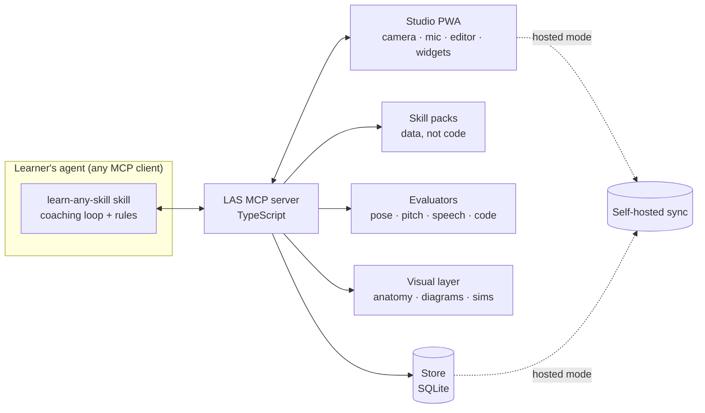

# Learn Any Skill (LAS): Design

Status: draft · Prototype: [`prototypes/onboarding/index.html`](../prototypes/onboarding/index.html)

| Doc | Covers |
|---|---|
| **This overview** | Principles, prior art, architecture, onboarding, run modes, open-source policy, build plan |
| [Learning loop](design/learning-loop.md) | Today screen, what happens in a session, session planner, teaching cards, drills, feedback, check-ins, re-planning, progress, proof checks |
| [Evaluation](design/evaluation.md) | Evaluator contract, analysis pipeline, the video coach, mistake library, proof standards, confidence |
| [MCP and data](design/mcp-and-data.md) | Tool contracts, resources, prompts, agent rules, events, data model, sync, security |
| [Skill packs](design/skill-packs.md) | Pack layout, ladder and skill graph, lessons, drills, validation, packs drafted for new skills, content licensing |

LAS is an open-source MCP server and agent skill that coach someone through learning any skill, such as guitar, bouldering, Spanish or Python. It does four things:

- sets a goal the learner cares about;
- teaches with visuals and interaction rather than text;
- checks real practice (recordings, video, code) against a clear standard of proof;
- follows up until the goal is reached.

It follows the same pattern as [REA](https://github.com/morluto/rea): one installable server plus one skill. The agent does the reasoning, and proven open-source tools supply the measurements.

---

## 1. Principles

1. **Show, don't tell.** Explanations are diagrams, simulations, animations or video. The coach never writes an essay; a few sentences between visuals is the most it writes.
2. **Every milestone has a proof.** A goal is done when the evidence passes, such as a recording, a clip or passing tests, not when the learner says so.
3. **Personal by construction.** Answer options, suggestions and the plan are computed from the learner's own answers (see §5.3). Nothing after the first question is the same for everyone.
4. **One flow for every skill.** Every skill pack fills the same slots, so guitar, Spanish and a skill we've never seen go through the same screens with the same controls.
5. **Measure, then coach.** Evaluators produce numbers (joint angles, timing in ms, test results). The language model explains those numbers; it doesn't judge raw video or audio itself.
6. **Open source only.** Every dependency is open source and free for anyone to use, including commercially (§11).
7. **Local first.** Runs fully on the learner's own machine. Hosted mode is optional and exists for mobile.

## 2. Prior art and what's new

| Project | What it covers | What it lacks |
|---|---|---|
| [tutor-mcp](https://github.com/ArnaudGuiovanna/tutor-mcp) (MIT) | Concept graph with prerequisites, mastery tracking (BKT), spaced repetition (FSRS), goals across sessions | Text only; no visuals, audio, video or movement checks |
| [learning-tool-mcp](https://github.com/Hemosoo/learning-tool-mcp) (MIT) | Flashcard and quiz widget shown inside the chat (MCP Apps) | PDF study material only |
| Gemini Guided Learning, ChatGPT Study Mode | Visual or guided tutoring | Closed, can't be extended, no physical skills |
| Climbing coach apps (Climbah, BetterClimber) | Video coaching for one sport | One skill each; not an agent tool |
| Roadmap apps (Learni, SkillMap) | Roadmap for any topic | Don't check real practice |

**What's new in LAS:** one REA-style package that combines a curriculum engine, interactive visuals, and pluggable checkers for code, audio, speech and movement. We should reuse ideas from tutor-mcp and learning-tool-mcp (both MIT) rather than rebuild them.

## 3. Architecture



```
las-agents (npm)  →  npx las-agents setup
├── skill/        learn-any-skill: coaching loop, "show, don't tell" rules, when to call each tool
├── server/       MCP server (stdio locally, streamable HTTP when hosted)
├── studio/       PWA: onboarding, camera/mic capture, code editor, widgets
├── evaluators/   one adapter per way of checking practice (§8)
├── packs/        guitar/, bouldering/, spanish/, python/, … (§6)
└── store/        SQLite: profile, milestones, mastery, review queue, sessions
```

**Interactivity.** Tools return [MCP Apps](https://github.com/modelcontextprotocol/ext-apps) widgets where the client shows them inline in the chat. Everything else (camera capture, the code editor, long sessions) runs in the studio PWA. Both use the same components, so a screen looks the same in either place.

## 4. MCP tool surface

| Group | Tools |
|---|---|
| `onboard` | `start_intake`, `record_answer`, `place_learner`, `suggest_milestones`, `check_feasibility`, `set_milestone` |
| `plan` | `get_today`, `next_session`, `reschedule`, `replan` |
| `teach` | `render_lesson`, `render_mechanism` (anatomy), `render_diagram`, `explain_mistake` |
| `practice` | `start_drill`, `review_cards` (FSRS) |
| `evaluate` | `request_capture`, `get_analysis`, `run_proof_check` |
| `track` | `get_progress`, `get_session_summary`, `log_external`, `report_pain`, `revisit_why`, `export_data`, `delete_data` |

Lesson tools take **structured specs** and reject text over budget, so the tool shapes leave no room for an essay. Inputs, outputs, agent rules and events: [MCP and data](design/mcp-and-data.md).

## 5. Onboarding

Onboarding produces three things: **why** they're learning, **what they want to be doing** afterwards, and **one first milestone with a proof**. Everything else (placement, plan, check-ins) follows from these.

### 5.1 Flow

| # | Section | Screen | Answer type |
|---|---|---|---|
| 1 | Skill | "What do you want to learn?" | single (tiles) or free text |
| 2 | Why | "What's pulling you toward {skill}?" | multi, up to 2 |
| 3 | Picture it | "Six months from now, what are you doing?" | single, re-ranked by why · or free text |
| 4 | Level | 1–3 skill-check screens from the pack | standard types (§5.2) |
| 4 | Level | "Here's where you start" | placement, with "too easy" / "too hard" buttons |
| 5 | Time | Hours per week and deadline | slider, single |
| 5 | Time | "Anything we should plan around?" | multi: equipment and injuries |
| 6 | Milestone | "Pick your first milestone" | suggestions · own words · tap a ladder step |
| 7 | Plan | Target, route, practice mix, check-ins, stored profile | — |

### 5.2 One screen, every skill

Every screen has the same frame:

- progress bar with one segment per section;
- a **row of answer chips** showing everything answered so far (tap one to edit it);
- one question and one answer component;
- one sticky main button, with a secondary action under it in the same place every time.

Answer components are standardized. A pack chooses which ones to use but can't invent new ones:

| Type | Used for | Behavior |
|---|---|---|
| `single` | Choosing one option | Moves on automatically after a tap |
| `multi` | Selecting several | Button reads "Skip" / "None of these" until something is picked |
| `holds` | Grades and levels | Like `single`, drawn as climbing holds |
| `chords` | Visual multi-select | Diagrams instead of words |
| `quiz` | Knowledge check | Gets harder each question and stops after 2 wrong answers |
| `beat` | Short practical test | Measures timing (ms off the beat) |
| `clip` | Video evidence | Optional; analyzed on the device |

The first skill-check screen always offers **"I'm completely new to this"**, which skips straight to placement.

### 5.3 What adapts to what

| Output | Inputs | Rule |
|---|---|---|
| Why options | skill | Each pack has its own wording (bouldering: "Push my limits"; Python: "Save time at work") |
| Six-month picture options | why | Each option is tagged with the reasons it fits; matches go first with a "Fits your why" badge |
| Starting point | answers to the skill checks, plus "too easy" / "too hard" | Each pack's `place()` maps the evidence to a ladder step; the learner can move it one step at a time |
| Equipment options | skill + picture | Pack basics plus what the picture needs (outdoor climbing adds *crash pad*, *climbing partner*) |
| Suggested milestones | starting point, time, deadline, picture, why | **Quick win** = next step. **Stretch** = furthest step reachable in about 6 weeks. **Toward your picture** = the picture's own milestone. A deadline, or a reason like a trip, event or exam, puts the quick win first; otherwise the picture's milestone leads |
| Feasibility | estimated hours per step, time per week, deadline | Realistic / fits your deadline / ambitious / long road, with a closer "stepping stone" milestone offered when the goal is too far |
| Practice mix | picture, starting point, injuries | Starts from the picture's mix; beginners get +10 to fundamentals; an injury lowers the hard-training categories and adds recovery and prehab |
| Injury rules on the plan | injuries | Each pack maps an injury to a rule (fingers → open-hand grips first, no hangboard for 8 weeks) |
| Wording of each question | earlier answers | Questions quote what the learner already said ("Your first step toward playing at a friend's wedding") |

In the prototype these are rules over pack data. In the product the agent can also **generate** options for skills that have no pack, using the same schemas, so a generated option still goes through the same placement and feasibility logic.

### 5.4 Learner profile (stored)

```json
{
  "skill": "Bouldering",
  "intent": { "why": ["Push my limits", "A trip to real rock"], "afterwards": "Climbing outdoors" },
  "baseline": { "step": "V1", "evidence": { "grade": 2, "moves": ["Flagging"] }, "adjustedByLearner": 0 },
  "constraints": { "minutesPerWeek": 180, "deadlineWeeks": 13, "access": ["Climbing gym", "Crash pad"], "injuries": ["Fingers"] },
  "milestones": [{
    "goal": "Send your first outdoor boulder",
    "ladderStep": "Send a V2",
    "proof": { "evaluator": "video", "pass": "Video of a clean send on rock, pads and spotter set up right" },
    "estimateWeeks": 5, "targetDate": "2026-11-16", "feasibility": "Fits your deadline"
  }],
  "focus": { "Footwork": 34, "Reading problems": 29, "Falling & spotting": 19, "Strength": 8, "Recovery & prehab": 10 },
  "checkins": { "sessionsPerWeek": 4, "minutesEach": 45, "days": ["Mon", "Tue", "Thu", "Sat"] }
}
```

**When a milestone is reached:** `revisit_why` asks the why and six-month questions again, because goals change.

## 6. Skill packs

A pack is data. Each one fills the same slots. The full layout (skill graph, lessons, drills, mistakes, proofs, validation, packs drafted for new skills) is in [Skill packs](design/skill-packs.md).

```ts
interface SkillPack {
  name: string; noun: string; evaluator: Evaluator;
  why: { id: string; label: string }[];                       // reasons, worded for this skill
  pictures: { id: string; label: string; why: string[];       // tagged with the reasons they fit
              ladderStep: number; milestone: string; proof: string;
              focus: Record<string, number>; access?: string[] }[];
  probes: Probe[];                                            // standard answer types only (§5.2)
  place(evidence): number;                                    // evidence → ladder step
  ladder: { label: string; hours: number; proof: string }[];  // estimated hours to reach each step
  access: string[]; injuries?: Record<string, string>;        // injury → training rule
}
```

The estimated hours per step are rough placeholders in the prototype. Before launch they need real sources (published coaching guides, CEFR hour estimates, our own data once people use it).

## 7. Teaching visuals

| Content | Tool |
|---|---|
| How a mechanism works (engine, lock, heart) | [anatomy](https://github.com/wheresryan22/anatomy), cached per concept because generating a figure is slow |
| Flows, processes, concept maps | Mermaid, Excalidraw |
| Data and simulations | D3, three.js |
| Math and physics animations | Manim, Motion Canvas |
| Music | abcjs or VexFlow (notation), OpenSheetMusicDisplay (MusicXML), Tone.js (playback) |
| The body and movement | Pose-overlay replays of the learner's own clips (anatomy doesn't draw people) |

## 8. Evaluators

| Modality | Measures | Open-source stack |
|---|---|---|
| Movement | Joint angles, hip-to-wall distance, centre of mass over feet, smoothness | MediaPipe Pose and Hand Landmarker running on the device, in the browser; MoveNet as a fallback |
| Audio performance | Pitch accuracy, onset timing, tempo drift | basic-pitch, torchcrepe or CREPE, librosa |
| Speech | Transcript, words per minute, pronunciation score | whisper.cpp or faster-whisper; Kaldi's pronunciation-scoring recipe; Montreal Forced Aligner |
| Code | Hidden tests, runtime errors | Pyodide in the browser; CodeMirror 6 editor |
| Knowledge | Quiz accuracy, recall over time | Built in, plus ts-fsrs |
| Crafts (drawing, pottery) | Coach review of uploaded work | The agent's vision model, guided by a rubric from the pack |

Video stays on the device. Only body-position data and a few annotated key frames go to the agent.

**Single-camera limits:** a phone camera is good for big movements (climbing, squats, a golf swing) and weak for fine finger work. Hand tracking helps with guitar, but camera angle matters. The video coach is never the authority on safety.

Details (pipeline, video coach, mistake library, proof standards): [Evaluation](design/evaluation.md).

## 9. Learner model and follow-ups

- **Mastery:** Bayesian Knowledge Tracing over the skill's ladder and concept graph. We'll implement it in TypeScript; pyBKT (MIT) is the reference.
- **Reviews:** FSRS spaced repetition via ts-fsrs.
- **Follow-ups:** an MCP server can't start a conversation, so LAS stores a schedule of check-ins. Something else has to trigger them: the client's scheduler, studio notifications (Web Push), or a cron job when hosted. Each check-in looks at what was done since the last one and moves the plan forward or reschedules it.

Sessions, the planner, feedback, check-ins and re-planning: [Learning loop](design/learning-loop.md).

## 10. Where it runs

| Mode | How | For | Limits |
|---|---|---|---|
| **Local** | MCP server and studio on `localhost` | Desk skills, privacy | No phone |
| **Phone as camera** | Studio shows a QR code; the phone joins over the local network, using HTTPS from mkcert, or over Headscale | Filming hands or a full-body routine at home | The computer must stay on |
| **Hosted** | Remote MCP server plus studio PWA plus self-hosted sync | Gyms, outdoors, anything on the go | We run the infrastructure |

**Mobile:** the studio is a PWA from day one, so the same code runs in all three modes.

- Attempts can be recorded with no signal and are uploaded later.
- Body tracking runs on the phone.
- Web Push works on iOS only after the app is added to the home screen (iOS 16.4+).
- If background recording or better camera control is needed later, wrap the studio in Expo / React Native.

## 11. Open-source policy

**Rule:** every dependency must be open source, and its license must let anyone use, modify and redistribute it for free, including commercially. LAS itself is MIT.

| Status | Licenses |
|---|---|
| Allowed | MIT, BSD-2/3, ISC, Apache-2.0, public domain, SIL OFL (fonts), CC-BY-4.0 (data, with attribution) |
| Allowed with care | MPL-2.0: use unmodified, or publish changes to those files |
| Not allowed | GPL/AGPL code linked into LAS, non-commercial terms (CC-NC), source-available terms (FSL, BSL), custom model licenses that aren't open source, proprietary hosted services as required dependencies |

CI will run a license check on every dependency, and adding a new license type needs a design-doc update.

### 11.1 Chosen components

Verified from each project's LICENSE file or model card on 2026-10-12. ⚠ means it still needs a check before we ship it.

| Area | Component | License |
|---|---|---|
| MCP | TypeScript SDK, ext-apps (MCP Apps) | Apache-2.0 (older code MIT) |
| Visuals | anatomy | MIT ⚠ (license badge only) |
| | Mermaid, Excalidraw, three.js, Motion Canvas, Manim | MIT |
| | D3 | ISC |
| | abcjs, VexFlow, Tone.js | MIT |
| | OpenSheetMusicDisplay | BSD-3-Clause |
| Movement | MediaPipe code, plus Pose and Hand Landmarker models | Apache-2.0 (code and model cards) |
| | MoveNet | Apache-2.0 (code and model card) |
| Audio | basic-pitch | Apache-2.0, model included |
| | CREPE, torchcrepe | MIT |
| | librosa | ISC |
| Speech | Whisper (code and weights), whisper.cpp, faster-whisper | MIT |
| | Kaldi, including the pronunciation-scoring recipe | Apache-2.0 |
| | speechocean762 data | "free for commercial use" ⚠ formal license |
| | Montreal Forced Aligner | MIT; models CC-BY-4.0 ⚠ check each model |
| | Vosk | Apache-2.0 ⚠ only Apache-licensed models |
| Code | Pyodide | MPL-2.0 |
| | CodeMirror 6, Monaco | MIT |
| Learner model | ts-fsrs, py-fsrs, pyBKT | MIT |
| Pack tooling | yaml (YAML parser) | ISC |
| Storage and sync | SQLite | Public domain |
| | libSQL, PocketBase | MIT |
| | ElectricSQL, Supabase (self-hosted) | Apache-2.0 |
| Mobile and network | Workbox, Expo, React Native | MIT |
| | web-push | MPL-2.0 |
| | mkcert, Headscale | BSD-3-Clause |
| | Tailscale client | BSD-3-Clause (some platform GUIs are not open source) |
| Fonts | Gabarito, Atkinson Hyperlegible, DM Mono | SIL OFL 1.1 |

**A fully open agent stack.** LAS doesn't bundle a model; it runs inside whatever MCP client the learner uses. LAS must work end to end with:

- open clients: Goose (Apache-2.0), OpenCode (MIT), Continue (Apache-2.0) or Cline (Apache-2.0);
- local models through Ollama (MIT), using Qwen3 (Apache-2.0) or Mistral's Apache-2.0 models ⚠ check each model's license file.

Because evaluators turn practice into numbers, a text-only open model can coach well. ⚠ Check which open clients show MCP Apps widgets; until they do, the studio PWA is the fallback.

### 11.2 Rejected, and what we use instead

| Rejected | Why | Use instead |
|---|---|---|
| Ultralytics YOLO pose | AGPL-3.0, and the vendor says trained models are covered too | MediaPipe, MoveNet |
| RTMPose weights | No license stated for the weights | MediaPipe, MoveNet (RTMPose code is Apache-2.0; revisit if the weights get a license) |
| Essentia | AGPL-3.0 code; non-commercial models | librosa, basic-pitch |
| aubio | GPL-3.0 | librosa, torchcrepe |
| Allosaurus | GPL-3.0 | Kaldi pronunciation-scoring recipe |
| Judge0 | GPL-3.0 | Pyodide |
| p5.js | LGPL-2.1 | three.js, D3, Motion Canvas |
| PowerSync service | FSL (source-available, not open source) | ElectricSQL, libSQL |
| Cloudflare Tunnel service, Tailscale coordination server | Proprietary hosted services | Headscale, frp (Apache-2.0 ⚠ license badge only) |
| Llama, Gemma 1–3n, Qwen2.5-3B/72B, Mistral Large 2, Codestral | Custom or non-commercial model licenses | Qwen3, Mistral Apache-2.0 models, Gemma 4 ⚠ verify |
| Commercial pronunciation APIs | Proprietary | Kaldi pronunciation-scoring recipe |

## 12. Privacy and safety

- Video and audio are processed on the device by default. Only derived data (body landmarks, pitch tracks, scores) and learner-chosen key frames leave it.
- The learner owns the store: export and delete are tools, not support tickets.
- For physical skills, an injury flag changes the plan (§5.3), and the coach tells the learner to see a professional when pain comes up. Climbing safety (falling, spotting, pad placement) is taught, never assumed.

## 13. Build plan

| Phase | Deliverable |
|---|---|
| 0 | Clickable onboarding prototype ✅ |
| 1 | MCP server, store, onboarding tools as MCP Apps widgets, the skill, and two packs (Python for quizzes and code, bouldering for movement) |
| 2 | Evaluators: movement (MediaPipe in the studio), code (Pyodide), audio (basic-pitch), speech (whisper.cpp + pronunciation scoring) |
| 3 | Studio PWA with phone pairing; FSRS reviews; scheduled check-ins |
| 4 | Hosted mode: remote MCP, self-hosted sync, Web Push |
| 5 | Pack authoring kit, packs generated by the agent for any skill, community packs |

## 14. Open questions

- Where do the estimated hours per step come from, and how do we correct them from real progress?
- Which open MCP clients render MCP Apps today, and what's our fallback when they don't?
- How should a generated pack for an unknown skill be checked before a learner relies on it?
- Which skills need a human coach in the loop (anything with real injury risk beyond bouldering)?
