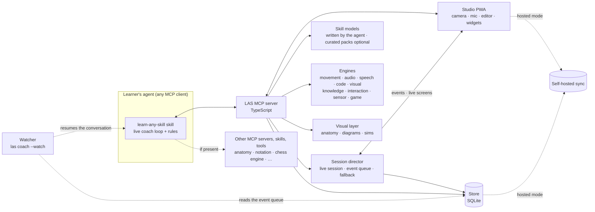

# Learn Any Skill (LAS): Design

Status: draft · Prototype: [`prototypes/app/index.html`](../prototypes/app/index.html) (onboarding, first session, Today, Progress; sample analysis results)

| Doc | Covers |
|---|---|
| **This overview** | Principles, prior art, architecture, onboarding, run modes, open-source policy, build plan |
| [Any skill](design/any-skill.md) | **Start here.** How LAS covers any skill with no per-skill code: engines, spec languages, any programming language, finding and choosing tools, generated skill models, safety, coverage targets |
| [Theming](design/theming.md) | The learner picks the look (a design prompt, a description, a screenshot or a tokens file); the theme spec, accessibility and font-license checks, where themes apply |
| [Learning loop](design/learning-loop.md) | Today screen, what happens in a session, session planner, teaching cards, drills, feedback, check-ins, re-planning, progress, proof checks |
| [Live coach](design/live-coach.md) | The agent coaches during practice: the coach loop, the watcher that re-wakes it, MCP Apps widgets, events and screens, the session director, the fallback when no coach is reachable |
| [Evaluation](design/evaluation.md) | Evaluator contract, analysis pipeline, the video coach, mistake library, proof standards, confidence |
| [MCP and data](design/mcp-and-data.md) | Tool contracts, resources, prompts, agent rules, events, data model, sync, security |
| [Skill models](design/skill-packs.md) | The skill model schema (ladder, skill graph, lessons, drills, mistakes, proofs), scaffold vs fallback content, validation, generated vs curated, content licensing |

LAS is an open-source MCP server and agent skill that coach someone through learning any skill, such as guitar, bouldering, Spanish or Python. It does four things:

- sets a goal the learner cares about;
- teaches with visuals and interaction rather than text;
- checks real practice (recordings, video, code) against a clear standard of proof;
- follows up until the goal is reached.

It follows the same pattern as [REA](https://github.com/morluto/rea): one installable server plus one skill that give the agent extra capabilities. **LAS has no code for any particular skill.** The agent works out each skill at runtime: which kinds of evidence it needs, which tools are available, and what the plan, checks and rubrics should be. General-purpose open-source engines supply the measurements ([Any skill](design/any-skill.md)).

---

## 1. Principles

1. **Show, don't tell.** Explanations are diagrams, simulations, animations or video. The coach never writes an essay; a few sentences between visuals is the most it writes.
2. **Every milestone has a proof.** A goal is done when the evidence passes, such as a recording, a clip or passing tests, not when the learner says so.
3. **Personal by construction.** Answer options, suggestions and the plan are computed from the learner's own answers (see §5.3). Personalization happens twice: at model time, when the agent writes the skill model, and at screen time, when the live coach writes each next screen for what the learner just did (principle 9). Nothing after the first question is the same for everyone.
4. **General first.** No skill gets its own code. The agent writes a skill model for whatever the learner picks, using engines that don't know which skill they're measuring. Curated packs are optional improvements, never a requirement. Every skill goes through the same screens with the same controls.
5. **Measure, then coach.** Evaluators produce numbers (joint angles, timing in ms, test results). The language model explains those numbers; it doesn't judge raw video or audio itself.
6. **Open source only.** Every dependency is open source and free for anyone to use, including commercially (§11).
7. **Local first.** Runs fully on the learner's own machine. Hosted mode is optional and exists for mobile.
8. **The learner picks the look.** LAS has no fixed visual design language. The learner brings a style (a design prompt from a gallery, a description, a screenshot, a tokens file); the agent turns it into a theme; and every screen, widget, figure and overlay follows it. Accessibility checks always apply ([Theming](design/theming.md)).
9. **Live coach.** The agent is present during practice. It watches the learner move through the screens and writes each next screen for this learner, now. Pre-written content in the skill model is only a fallback for when no coach is reachable, so a session never blocks on a model. Live screens keep the same card types and word budgets ([Live coach](design/live-coach.md)).

## 2. Prior art and what's new

| Project | What it covers | What it lacks |
|---|---|---|
| [tutor-mcp](https://github.com/ArnaudGuiovanna/tutor-mcp) (MIT) | Concept graph with prerequisites, mastery tracking (BKT), spaced repetition (FSRS), goals across sessions | Text only; no visuals, audio, video or movement checks |
| [learning-tool-mcp](https://github.com/Hemosoo/learning-tool-mcp) (MIT) | Flashcard and quiz widget shown inside the chat (MCP Apps) | PDF study material only |
| Gemini Guided Learning, ChatGPT Study Mode | Visual or guided tutoring | Closed, can't be extended, no physical skills |
| Climbing coach apps (Climbah, BetterClimber) | Video coaching for one sport | One skill each; not an agent tool |
| Roadmap apps (Learni, SkillMap) | Roadmap for any topic | Don't check real practice |

**What's new in LAS:** one REA-style package that works for any skill. It combines a curriculum engine, interactive visuals, and general-purpose engines for movement, audio, speech, code, images, answers, sensors and games, all configured by the agent at runtime. We should reuse ideas from tutor-mcp and learning-tool-mcp (both MIT) rather than rebuild them.

## 3. Architecture



```
las-agents (npm)  →  npx las-agents setup
├── skill/        learn-any-skill: the live coach loop, "show, don't tell" rules, when to call each tool
├── server/       MCP server (stdio locally, streamable HTTP when hosted) and the session director
├── cli/          setup, checkin, and the watcher (las coach --watch) that re-wakes the coach
├── studio/       PWA: onboarding, camera/mic capture, code editor, widgets; everything drawn from the active theme
├── engines/      general-purpose measurement, configured by specs (§8)
├── runners/      code runners: browser, local toolchain, container
├── packs/        optional curated skill models; never required (§6)
└── store/        SQLite: profile, milestones, mastery, review queue, sessions, live sessions and the coach's event queue
```

**Interactivity.** Tools return [MCP Apps](https://github.com/modelcontextprotocol/ext-apps) widgets where the client shows them inline in the chat. Everything else (camera capture, the code editor, long sessions) runs in the studio PWA. Both use the same components and the learner's theme, so a screen looks the same in either place.

**The live coach.** During practice the agent stays in a loop (`coach_wait` → decide → `coach_show`) and writes each next screen. The **session director** in the server holds the live session, queues studio events for the coach, validates and shows its screens, and serves the skill model's fallback content when no coach is present. The **watcher** (`las coach --watch`) resumes the coach's conversation headlessly when the learner acts and no coach is listening. Details: [Live coach](design/live-coach.md).

### 3.1 Repository layout

The tree above is the product as the learner installs it. The repository is a pnpm workspace (`packages/*` and `evals`):

| Path | Package | Holds |
|---|---|---|
| `packages/schema` | `@las/schema` | Skill model, theme, spec languages, expression language, analyses and events, with their validators |
| `packages/store` | `@las/store` | SQLite through `node:sqlite`, with migrations |
| `packages/engines` | `@las/engines` | The measurement engines (§8). `node.ts` holds the adapters that start separate processes (UCI and GTP engines, whisper.cpp) |
| `packages/runners` | `@las/runners` | Code runners (browser, local toolchain, container) and the table of languages |
| `packages/server` | `@las/server` | The MCP server (tools, resources, prompts), the learning loop, the session director (v0.2), and the studio's local JSON API |
| `packages/ui` | `@las/ui` | Themeable components, screens and figures, and the theme-to-CSS generator |
| `packages/studio` | `@las/studio` | The studio PWA and the MCP Apps widget (Vite + Preact) |
| `packages/cli` | `las-agents` | `setup`, `serve`, `doctor`, `studio`, `checkin`, `engines test`, `model validate`; from v0.2 `coach --watch` and `coach --once` (the watcher and its table of client adapters) and `client-session` (the Claude Code SessionStart hook that records the conversation id) |
| `skill/` | | The `learn-any-skill` skill and its reference pages |
| `evals/` | `@las/evals` | Theme fixtures and agent evals (§9 of [Any skill](design/any-skill.md#9-keeping-quality-up-without-per-skill-code)) |
| `tools/` | | License check, style check, the ESLint rule for hard-coded styles, the Inspector smoke test |
| `docs/`, `prototypes/app` | | These design docs and the clickable prototype |

`packs/` in the tree above does not exist in v0.1: no curated packs ship (§13), and every skill model is stored in the database.

## 4. MCP tool surface

| Group | Tools |
|---|---|
| `skill` | `get_capabilities`, `draft_skill_model`, `validate_skill_model`, `get_skill_model` |
| `theme` | `draft_theme`, `validate_theme`, `preview_theme`, `set_theme`, `get_theme` |
| `onboard` | `start_intake`, `record_answer`, `place_learner`, `suggest_milestones`, `check_feasibility`, `set_milestone` |
| `plan` | `get_today`, `next_session`, `reschedule`, `replan` |
| `teach` | `render_lesson`, `render_sim`, `render_mechanism` (anatomy), `render_diagram`, `explain_mistake` |
| `practice` | `start_drill`, `review_cards` (FSRS) |
| `evaluate` | `request_capture`, `get_analysis`, `run_code_tests`, `compare_to_reference`, `run_proof_check`, `submit_rubric_grade` (the agent's own rubric grades for a picture, which `get_analysis` hands it) |
| `track` | `get_progress`, `get_session_summary`, `log_external`, `report_pain`, `revisit_why`, `export_data`, `delete_data` |
| `coach` (v0.2) | `coach_start`, `coach_wait`, `coach_show`, `coach_end`: the live coach loop ([Live coach](design/live-coach.md)) |

Lesson tools and `coach_show` take **structured specs** and reject text over budget, so the tool shapes leave no room for an essay. Inputs, outputs, agent rules and events: [MCP and data](design/mcp-and-data.md).

## 5. Onboarding

Onboarding produces three things: **why** they're learning, **what they want to be doing** afterwards, and **one first milestone with a proof**. Everything else (placement, plan, check-ins) follows from these.

### 5.1 Flow

| # | Section | Screen | Answer type |
|---|---|---|---|
| 0 | Look | "Pick a look": paste a design prompt, describe it, add a screenshot, or skip | optional; preview of their own screens in the theme |
| 1 | Skill | "What do you want to learn?" | single (tiles) or free text |
| 2 | Why | "What's pulling you toward {skill}?" | multi, up to 2 |
| 3 | Picture it | "Six months from now, what are you doing?" | single, re-ranked by why · or free text |
| 4 | Level | 1–3 skill-check screens from the skill model | standard types (§5.2) |
| 4 | Level | "Here's where you start" | placement, with "too easy" / "too hard" buttons |
| 5 | Time | Hours per week and deadline | slider, single |
| 5 | Time | "Anything we should plan around?" | multi: equipment and injuries |
| 6 | Milestone | "Pick your first milestone" | suggestions · own words · tap a ladder step |
| 7 | Plan | Target, route, practice mix, check-ins, stored profile | — |

### 5.2 One screen, every skill

Every screen has the same frame:

- progress bar with one segment per section;
- a **row of answer chips** showing everything answered so far (tap one to edit it);
- one question and one answer component;
- one sticky main button, with a secondary action under it in the same place every time.

Answer components are standardized. A skill model chooses which ones to use but can't invent new ones:

| Type | Used for | Behavior |
|---|---|---|
| `single` | Choosing one option | Moves on automatically after a tap |
| `multi` | Selecting several | Button reads "Skip" / "None of these" until something is picked |
| `scale` | Grades, belts, levels | Like `single`, drawn in the skill's own terms (climbing holds, belt colors, CEFR levels) |
| `visual-multi` | Selecting from pictures | Diagrams instead of words (chord shapes, poses, characters) |
| `quiz` | Knowledge check | Gets harder each question and stops after 2 wrong answers |
| `tap` | Short timing test | Measures timing (ms off the beat) |
| `record` | Short audio or video check | Optional; analyzed by the right engine on the device |
| `code` | Short coding check | Runs with the best available code runner |

The first skill-check screen always offers **"I'm completely new to this"**, which skips straight to placement.

### 5.3 What adapts to what

| Output | Inputs | Rule |
|---|---|---|
| Why options | skill | Each skill model has its own wording (bouldering: "Push my limits"; Python: "Save time at work") |
| Six-month picture options | why | Each option is tagged with the reasons it fits; matches go first with a "Fits your why" badge |
| Starting point | answers to the skill checks, plus "too easy" / "too hard" | The skill model's placement rules map the evidence to a ladder step; the learner can move it one step at a time |
| Equipment options | skill + picture | The skill's basics plus what the picture needs (outdoor climbing adds *crash pad*, *climbing partner*) |
| Suggested milestones | starting point, time, deadline, picture, why | **Quick win** = next step. **Stretch** = furthest step reachable in about 6 weeks. **Toward your picture** = the picture's own milestone. A deadline, or a reason like a trip, event or exam, puts the quick win first; otherwise the picture's milestone leads |
| Feasibility | estimated hours per step, time per week, deadline | Realistic / fits your deadline / ambitious / long road, with a closer "stepping stone" milestone offered when the goal is too far |
| Practice mix | picture, starting point, injuries | Starts from the picture's mix; beginners get +10 to fundamentals; an injury lowers the hard-training categories and adds recovery and prehab |
| Injury rules on the plan | injuries | The skill model maps an injury to a rule (fingers → open-hand grips first, no hangboard for 8 weeks) |
| Wording of each question | earlier answers | Questions quote what the learner already said ("Your first step toward playing at a friend's wedding") |

The rules themselves are general code in LAS. The data they work on (options, tags, ladder, placement rules) comes from the skill model the agent writes. The prototype hard-codes four example skills to show the UX; the product generates this data for any skill.

### 5.4 Learner profile (stored)

```json
{
  "skill": "Bouldering",
  "intent": { "why": ["Push my limits", "A trip to real rock"], "afterwards": "Climbing outdoors" },
  "baseline": { "step": "V1", "evidence": { "grade": 2, "moves": ["Flagging"] }, "adjustedByLearner": 0 },
  "constraints": { "minutesPerWeek": 180, "deadlineWeeks": 13, "access": ["Climbing gym", "Crash pad"], "injuries": ["Fingers"] },
  "milestones": [{
    "goal": "Send your first outdoor boulder",
    "ladderStep": "Send a V2",
    "proof": { "evaluator": "video", "pass": "Video of a clean send on rock, pads and spotter set up right" },
    "estimateWeeks": 5, "targetDate": "2026-11-16", "feasibility": "Fits your deadline"
  }],
  "focus": { "Footwork": 34, "Reading problems": 29, "Falling & spotting": 19, "Strength": 8, "Recovery & prehab": 10 },
  "checkins": { "sessionsPerWeek": 4, "minutesEach": 45, "days": ["Mon", "Tue", "Thu", "Sat"] }
}
```

**When a milestone is reached:** `revisit_why` asks the why and six-month questions again, because goals change.

## 6. Skill models

A skill model is data, and the agent writes it for whatever skill the learner picks ([Any skill §6](design/any-skill.md#6-skill-models)). Curated packs are skill models a person has reviewed; they improve quality but are never required. The full schema is in [Skill models](design/skill-packs.md). In short:

```ts
interface SkillModel {
  source: "generated" | "curated"; engines: EngineId[];       // which kinds of evidence this skill needs
  name: string; noun: string;
  why: { id: string; label: string }[];                       // reasons, worded for this skill
  pictures: { id: string; label: string; why: string[];       // tagged with the reasons they fit
              ladderStep: number; milestone: string; proof: string;
              focus: Record<string, number>; access?: string[] }[];
  probes: Probe[];                                            // standard answer types only (§5.2)
  placement: PlacementRule[];                                 // evidence → ladder step, as data
  ladder: { label: string; hours: [number, number];           // hour range to reach each step
            proof: ProofSpec }[];                             // bound to an engine spec
  access: string[]; injuries?: Record<string, string>;        // injury → training rule
  safety?: SafetyFields;                                      // required for physical skills
}
```

Hours per step are ranges. The agent cites sources when it can search the web, and LAS corrects them from the learner's real pace.

From v0.2 the model is a **scaffold** (ladder, skill graph, engine specs, mistakes with fix drills, safety, why, pictures, probes, placement) plus **fallback content** (lesson cards, practice items, feedback headlines, why explanations) that the studio uses only when no coach is present. `validate_skill_model` checks both ([Skill models §3.1](design/skill-packs.md#31-scaffold-and-fallback-content)).

## 7. Teaching visuals

| Content | Tool |
|---|---|
| How a mechanism works (engine, lock, heart) | [anatomy](https://github.com/wheresryan22/anatomy), cached per concept because generating a figure is slow |
| Flows, processes, concept maps | Mermaid, Excalidraw |
| Data and simulations | D3, three.js |
| Math and physics animations | Manim, Motion Canvas |
| Music | abcjs or VexFlow (notation), OpenSheetMusicDisplay (MusicXML), Tone.js (playback) |
| The body and movement | Pose-overlay replays of the learner's own clips (anatomy doesn't draw people) |

## 8. Engines

Engines are general-purpose; the agent configures them with specs (metric, rubric, test and audio reference specs). Full table and examples: [Any skill §2–4](design/any-skill.md#2-engines).

| Engine | Measures | Open-source stack |
|---|---|---|
| Movement | Joint angles, speeds, repetitions, range of motion, symmetry, balance, similarity to a reference, timing on the beat | MediaPipe Pose, Hand and Face Landmarker plus Object Detector on the device; MoveNet as a fallback |
| Audio | Notes, pitch error, timing, tempo, chords, compared with a score or recording | basic-pitch, torchcrepe or CREPE, librosa |
| Speech | Transcript, intelligibility, pace, pauses, pitch contour, per-sound scores where a model exists | whisper.cpp or faster-whisper; Kaldi pronunciation scoring; forced alignment |
| Code | Tests, errors, lint, in any language | Browser (Pyodide, SQLite WebAssembly, JavaScript), local toolchains, containers (Podman) |
| Visual | Rubric scores backed by measurements | The agent's vision model with a rubric spec; image measurements in the studio |
| Knowledge | Accuracy, recall over time | Built in, plus ts-fsrs |
| Interaction, sensor | Typing speed and accuracy; cadence, swing tempo, steadiness | Built into the studio |
| Game | Agreement with the engine's best move, blunders | An external engine the learner installs, run as a separate process |

Video stays on the device. Only body-position data and a few annotated key frames go to the agent.

**Single-camera limits:** a phone camera is good for big movements (climbing, squats, a golf swing) and weak for fine finger work. Hand tracking helps with guitar, but camera angle matters. The video coach is never the authority on safety.

Details (pipeline, video coach, mistake library, proof standards): [Evaluation](design/evaluation.md).

## 9. Learner model and follow-ups

- **Mastery:** Bayesian Knowledge Tracing over the skill's ladder and concept graph. We'll implement it in TypeScript; pyBKT (MIT) is the reference.
- **Reviews:** FSRS spaced repetition via ts-fsrs.
- **Follow-ups:** an MCP server can't start a conversation, so LAS stores a schedule of check-ins. Something else has to trigger them: the client's scheduler, studio notifications (Web Push), or a cron job when hosted. Each check-in looks at what was done since the last one and moves the plan forward or reschedules it.
- **The watcher (v0.2):** `las coach --watch` (cron-friendly with `--once`, like `las checkin`) watches the event queue. When the learner acts and no coach has called `coach_wait` in the last 60 s, it resumes the coach's conversation headlessly (Claude Code: `claude -p --resume`). One adapter per client, in a data table. While the coach's client is still open, or a client has no headless mode, it sends a notification instead ([Live coach §4](design/live-coach.md#4-mechanism-2-the-watcher)). Live check-ins, where the coach words a due check-in for the learner, are designed but not built.

Sessions, the planner, feedback, check-ins and re-planning: [Learning loop](design/learning-loop.md).

## 10. Where it runs

| Mode | How | For | Limits |
|---|---|---|---|
| **Local** | MCP server and studio on `localhost` | Desk skills, privacy | No phone |
| **Phone as camera** | Studio shows a QR code; the phone joins over the local network, using HTTPS from mkcert, or over Headscale | Filming hands or a full-body routine at home | The computer must stay on |
| **Hosted** | Remote MCP server plus studio PWA plus self-hosted sync | Gyms, outdoors, anything on the go | We run the infrastructure |

**Mobile:** the studio is a PWA from day one, so the same code runs in all three modes.

- Attempts can be recorded with no signal and are uploaded later.
- Body tracking runs on the phone.
- Web Push works on iOS only after the app is added to the home screen (iOS 16.4+).
- If background recording or better camera control is needed later, wrap the studio in Expo / React Native.

## 11. Open-source policy

**Rule:** every dependency must be open source, and its license must let anyone use, modify and redistribute it for free, including commercially. LAS itself is MIT.

| Status | Licenses |
|---|---|
| Allowed | MIT, BSD-2/3, ISC, Apache-2.0, public domain, SIL OFL (fonts), CC-BY-4.0 (data, with attribution) |
| Allowed with care | MPL-2.0: use unmodified, or publish changes to those files |
| Optional external only | GPL tools the learner installs separately, which LAS calls as a separate process over a standard protocol (UCI for chess engines, GTP for go engines, a command line). Never bundled, linked or required; a fallback always exists |
| Not allowed | GPL/AGPL code bundled or linked into LAS, non-commercial terms (CC-NC), source-available terms (FSL, BSL), custom model licenses that aren't open source, proprietary hosted services or runtimes as required dependencies |

CI will run a license check on every dependency, and adding a new license type needs a design-doc update.

### 11.1 Chosen components

Verified from each project's LICENSE file or model card on 2026-10-12 and 2026-10-13. ⚠ means it still needs a check before we ship it (usually because the model page couldn't be reached).

| Area | Component | License |
|---|---|---|
| MCP | TypeScript SDK, ext-apps (MCP Apps) | Apache-2.0 (older code MIT) |
| Visuals | anatomy | MIT ⚠ (license badge only) |
| | Mermaid, Excalidraw, three.js, Motion Canvas, Manim | MIT |
| | D3 | ISC |
| | abcjs, VexFlow, Tone.js | MIT |
| | OpenSheetMusicDisplay | BSD-3-Clause |
| Movement | MediaPipe code, plus Pose, Hand and Face Landmarker models | Apache-2.0 (code and model cards) |
| | MediaPipe Object Detector (EfficientDet-Lite) | Code Apache-2.0; weights ⚠ no model card states a license |
| | MediaPipe Gesture Recognizer | Hand model Apache-2.0; gesture classifier ⚠ card has no license field |
| | MoveNet | Apache-2.0 (code and model card) |
| | OpenCV.js (4.5.0 and later) | Apache-2.0 |
| Audio | basic-pitch | Apache-2.0, model included |
| | CREPE, torchcrepe | MIT |
| | librosa (including beat tracking) | ISC |
| | Pitchy (pitch, in the browser; used by the audio engine) | MIT (LICENSE file read, v4.1.0) |
| | Meyda (features and onsets, in the browser) | MIT. **Not used:** the audio engine computes spectral-flux onsets itself |
| | BeatNet (code and weights) | CC-BY-4.0. Its pip package pulls in madmom, whose model files are non-commercial: don't install or load them |
| Speech | Whisper (code and weights), whisper.cpp, faster-whisper | MIT |
| | Kaldi, including the pronunciation-scoring recipe | Apache-2.0 |
| | speechocean762 data | "free for commercial use" ⚠ formal license |
| | Montreal Forced Aligner | MIT; models CC-BY-4.0 ⚠ check each model |
| | Vosk | Apache-2.0 ⚠ only Apache-licensed models |
| | gruut, epitran (text to reference phonemes) | MIT |
| | wav2vec2 phoneme models (lv-60 and xlsr-53 espeak) | ⚠ reported Apache-2.0, model page not reachable |
| | Kokoro-82M (text to speech) | Code and weights Apache-2.0. Its default English phonemizer is GPL: use gruut instead |
| Code | Pyodide | MPL-2.0 |
| | sql.js | MIT |
| | SQLite WebAssembly build | Apache-2.0 wrapper; SQLite core public domain |
| | ruby.wasm | MIT (CRuby BSD-2-Clause or Ruby license) |
| | php-wasm | Apache-2.0 |
| | Wasmtime | Apache-2.0 with LLVM exception |
| | Emscripten | MIT or NCSA |
| | TinyGo | BSD-3-Clause |
| | Podman, Docker Engine (moby) | Apache-2.0 |
| | CodeMirror 6, Monaco | MIT |
| Visual | Tesseract.js plus tessdata models (reading handwriting and text) | Apache-2.0 |
| | ONNX Runtime Web | MIT |
| | Transformers.js | Apache-2.0 (each model checked separately) |
| | Local vision models for text-only agents: moondream2, SmolVLM/SmolVLM2, Florence-2, Qwen2.5-VL-7B | ⚠ reported Apache-2.0 or MIT, model pages not reachable |
| Game | chess.js | BSD-2-Clause |
| | cm-chessboard, react-chessboard (board UI) | MIT |
| | KataGo (go engine) | Code MIT; networks ⚠ reported MIT-style or CC0 |
| Learner model | ts-fsrs (used), py-fsrs, pyBKT (reference only; BKT is implemented in TypeScript) | MIT |
| Dev tooling | @modelcontextprotocol/inspector | Apache-2.0 (some older code MIT) |
| Pack tooling | yaml (YAML parser) | ISC. **Not used in v0.1** (no curated packs ship) |
| Storage and sync | SQLite | Public domain |
| | libSQL, PocketBase | MIT |
| | ElectricSQL, Supabase (self-hosted) | Apache-2.0 |
| Mobile and network | Workbox, Expo, React Native | MIT |
| | web-push | MPL-2.0 |
| | mkcert, Headscale | BSD-3-Clause |
| | Tailscale client | BSD-3-Clause (some platform GUIs are not open source) |
| Fonts | Any family a theme picks, if its license is one of OFL-1.1, Apache-2.0, MIT, UFL-1.0, CC0-1.0 or public domain, or it is a system font (`FONT_LICENSES` in packages/schema/src/theme/schema.ts); checked per family and cached locally. The prototype's demo fonts (Gabarito, Atkinson Hyperlegible, DM Mono) are OFL 1.1 | Per font |

#### What the repository depends on today

Every dependency in the `package.json` files, checked on 2026-10-13 against the installed package's `package.json` and, where the package ships one, its LICENSE file. CI re-checks all of them, and everything they pull in, with `pnpm run licenses` ([tools/check-licenses.mjs](../tools/check-licenses.mjs)).

| Package | Used by | License | Notes |
|---|---|---|---|
| `zod` 4 | schema, server | MIT | |
| `@modelcontextprotocol/sdk` 1.32 | server | MIT | |
| `@modelcontextprotocol/ext-apps` 1.7 | server, studio | MIT | The project is moving to Apache-2.0; both are allowed |
| `ts-fsrs` 5.4 | server | MIT | |
| `web-push` 3.6 | server | MPL-2.0 | Allowed with care: used unmodified. Sends opt-in check-in notifications |
| `chess.js` 1.4 | engines | BSD-2-Clause | |
| `pitchy` 4.1 | engines | MIT | |
| `node:sqlite` | store | Built into Node 22.13+ | SQLite itself is public domain |
| `preact` 10 | ui, studio | MIT | |
| `@mediapipe/tasks-vision` 1.1 | studio | Apache-2.0 | Code only. Model files: see the Movement rows above. The npm package has no LICENSE file; license read from `package.json` |
| `@huggingface/transformers` 4.3 | studio | Apache-2.0 | Runs Whisper in the browser. Whisper weights are MIT, but ⚠ verify the license on the `onnx-community` conversion's model card (the page was not reachable) |
| `tesseract.js` 7 | studio | Apache-2.0 | |
| `pyodide` 314 | studio | MPL-2.0 | Allowed with care: used unmodified. License read from `package.json` only |
| `sql.js` 1.14 | studio | MIT | |
| `qrcode` 1.5 | studio | MIT | Phone pairing QR code |
| `typescript` 5.9, `@playwright/test` 1.56 | dev | Apache-2.0 | |
| `vitest`, `vite` 8, `vite-plugin-singlefile`, `esbuild`, `tsx`, `eslint`, `@eslint/js`, `typescript-eslint`, `globals`, `preact-render-to-string`, `@types/node`, `@types/qrcode`, `@types/web-push` | dev | MIT | |
| `pnpm` 10 | tooling | MIT | The package manager, not a dependency |
| `lightningcss` | transitive (through `vite`) | MPL-2.0 | Allowed with care: used unmodified. CI prints it (and `pyodide`, `web-push`) as a warning |

`sharp` (it bundles an LGPL libvips binary) and `onnxruntime-node` are optional Node backends of `@huggingface/transformers` that the studio never loads; `overrides` in `pnpm-workspace.yaml` removes both so they are never installed.

Not in any `package.json`: Meyda, `yaml`, `happy-dom`, `@preact/preset-vite`, `vite-plugin-pwa` and Workbox. The other rows of the table above (Mermaid, Excalidraw, abcjs, VexFlow, CodeMirror and so on) are the components we chose for features that ship as data or later; none is a dependency yet.

**A fully open agent stack.** LAS doesn't bundle a model; it runs inside whatever MCP client the learner uses. LAS must work end to end with:

- open clients: Goose (Apache-2.0), OpenCode (MIT), Continue (Apache-2.0) or Cline (Apache-2.0);
- local models through Ollama (MIT), using Qwen3 (Apache-2.0) or Mistral's Apache-2.0 models ⚠ check each model's license file.

Because evaluators turn practice into numbers, a text-only open model can coach well. ⚠ Check which open clients show MCP Apps widgets; until they do, the studio PWA is the fallback.

### 11.2 Rejected, and what we use instead

| Rejected | Why | Use instead |
|---|---|---|
| Ultralytics YOLO pose | AGPL-3.0, and the vendor says trained models are covered too | MediaPipe, MoveNet |
| RTMPose weights | No license stated for the weights | MediaPipe, MoveNet (RTMPose code is Apache-2.0; revisit if the weights get a license) |
| Essentia | AGPL-3.0 code; non-commercial models | librosa, basic-pitch |
| aubio | GPL-3.0 | librosa, torchcrepe |
| Allosaurus | GPL-3.0 | Kaldi pronunciation-scoring recipe |
| Judge0 | GPL-3.0 | Pyodide |
| p5.js | LGPL-2.1 | three.js, D3, Motion Canvas |
| PowerSync service | FSL (source-available, not open source) | ElectricSQL, libSQL |
| Cloudflare Tunnel service, Tailscale coordination server | Proprietary hosted services | Headscale, frp (Apache-2.0 ⚠ license badge only) |
| Llama, Gemma 1–3n, Qwen2.5-3B/72B, Mistral Large 2, Codestral | Custom or non-commercial model licenses | Qwen3, Mistral Apache-2.0 models, Gemma 4 ⚠ verify |
| Commercial pronunciation APIs | Proprietary | Kaldi pronunciation-scoring recipe |
| Docker Desktop | Proprietary; larger companies must pay | Podman, Docker Engine |
| WebContainers (StackBlitz) | Proprietary runtime; paid for commercial production use | Wasmtime, Pyodide, ruby.wasm, php-wasm, sql.js, containers |
| Essentia.js | AGPL-3.0 | Meyda, Pitchy |
| aubio.js | No license; wraps GPL aubio | Pitchy, Meyda, librosa |
| madmom model files | CC BY-NC-SA (non-commercial) | librosa beat tracking, BeatNet's own weights |
| python-chess, chessground | GPL-3.0 | chess.js, cm-chessboard |
| Stockfish, Lc0 | GPL-3.0 | Optional external only, over UCI. Fallback: tactics quizzes with chess.js |
| espeak-ng, phonemizer, Piper TTS | GPL-3.0 | Optional external only. Use gruut or epitran for phonemes and Kokoro for speech |
| FFmpeg | LGPL-2.1+ (GPL in most builds) | Optional external only, as a separate process: when the learner has it on `PATH`, the server decodes a non-WAV recording with it for whisper.cpp. Fallback: WAV is decoded in node, and the studio transcribes in the browser |
| Qwen2.5-VL-3B | Research license (⚠ reported) | Qwen2.5-VL-7B, SmolVLM, Florence-2, moondream2 |
| Moondream 3 Preview | BSL 1.1 (source-available) | moondream2 |

## 12. Privacy and safety

- Video and audio are processed on the device by default. Only derived data (body landmarks, pitch tracks, scores) and learner-chosen key frames leave it.
- The learner owns the store: export and delete are tools, not support tickets.
- For physical skills, an injury flag changes the plan (§5.3), and the coach tells the learner to see a professional when pain comes up. Climbing safety (falling, spotting, pad placement) is taught, never assumed.

## 13. Build plan

| Phase | Deliverable |
|---|---|
| 0 | Clickable prototype: onboarding, a full first session (learn, practice, perform, one-fix feedback, fix drill, second attempt, wrap-up), Today with check-ins, and Progress ✅ |
| v0.1 ✅ | **Everything general, running locally:** MCP server, store, the skill with routing rules, `get_capabilities`, generating and validating skill models, onboarding, the learning loop, every engine in §8 with its spec language, code runners for any language, the studio PWA with phone pairing, learner-chosen themes for every surface, check-ins, `npx las-agents setup`, and agent evals across the coverage targets in [Any skill §8](design/any-skill.md#8-coverage-targets) |
|  | *What shipped (2026-10-13):* the 39-tool MCP server and skill; skill-model and theme validation; onboarding and the learning loop (planner, BKT, FSRS, check-ins, proof checks); all ten engines, code runners for 22 languages; the studio with on-device analysis, phone pairing and opt-in Web Push check-ins; `las-agents setup` for eight agents (run from the checkout; publishing to npm is not done yet); license, style, theme, engine and Inspector checks in CI. *Manual, not in CI:* runs with a real agent (the agent evals in `evals/` run offline, with scenarios written as data for each coverage target) and tests with real recordings (fixtures are synthetic). No curated packs. |
| v0.2 ✅ | **Live coach:** the `coach` tools (`coach_start`, `coach_wait`, `coach_show`, `coach_end`); the session director with the presence rule, screen queue and fallback; the new studio events and the ask-the-coach box; "coach here" and "coach away" in the studio; the `live_session`, `coach_event` and `coach_screen` tables; scaffold vs fallback content in the skill model; the planner as adviser with logged overrides; `las coach --watch` with the Claude Code adapter (Codex, OpenCode, Goose after); `las-agents setup` raising Claude Code's tool timeout and installing the session-id hook; the skill's loop rules; scripted-learner and scripted-coach tests ([Live coach](design/live-coach.md)). MCP Apps widget route after Claude Code |
|  | *What shipped (2026-10-13):* the four coach tools (43 tools in all) with `ack` and the learner-waiting return; the director with presence, the screen queue, the 8 s screen deadline, warm-up and recall shown by the director, takeovers, pause and the end of the day; every screen check; `plan.chosen`; the five live routes and four stream events; the studio's live runner (advance and wait, ask box, pause, hesitation, offline outbox, beacon, pings); optional fallback content with one warning per gap; `las coach --watch`/`--once` with the verified Claude Code adapter and push-then-OS notifications; setup's `MCP_TOOL_TIMEOUT` and SessionStart hook; `las doctor` checks. No new dependencies. *Not done:* `plan` screens outside a live session and live check-ins; latency tests with a real clock; `CoachSuggestion.fallbackScreenId` (never set); a route to dismiss a coach message; the widget's coach view is read-only; hesitation isn't in the end-to-end tests; the `/las-session` prompt still names the v0.1 flow; `las-agents serve` doesn't retry the studio port; no OS notifier on Windows; the Codex, OpenCode and Goose adapters are unverified ([Live coach](design/live-coach.md)). |
| v0.3 | Hosted mode: remote MCP, self-hosted sync, offline recording on phones, Web Push from a hosted server |
| v0.4 | Curated packs: review workflow, promoting generated models, community contributions |

## 14. Open questions

- Where do the estimated hours per step come from, and how do we correct them from real progress?
- Which open MCP clients render MCP Apps today, and what's our fallback when they don't?
- How much should a learner trust a generated skill model before anyone has reviewed it, and what signals should flag one for review?
- Where can learners legally get reference clips and scores (their own teacher's recording, public-domain scores, CC-licensed clips)?
- Which skills need a human coach in the loop (anything with real injury risk beyond bouldering)?
- **Live coach:** how LAS learns the conversation id in Codex, OpenCode and Goose, so the watcher can resume them (settled for Claude Code: a SessionStart hook) ([Live coach §17](design/live-coach.md#17-open-questions)).
- **Live coach:** what a coached session costs in tokens, per client and model (about 15–25 decision round trips in 30 minutes, plus heartbeats).
- **Live coach:** what the coach should do when the learner is silent, beyond one short nudge per screen.
