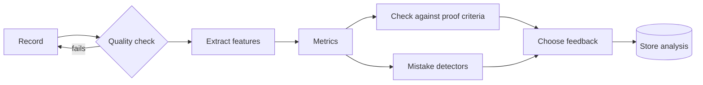

# Evaluation and the video coach

How LAS turns a recording, a clip or a piece of code into measurements, mistakes and a pass or fail against the proof standard, and how the video coach works.

Related: [learning loop](learning-loop.md) · [MCP and data](mcp-and-data.md) · [skill packs](skill-packs.md) · [overview](../DESIGN.md)

---

## 1. Evaluator contract

Each way of checking practice is one evaluator. All of them return the same result shape, so the planner, feedback and proof checks don't care which one produced it.

```ts
interface Evaluator {
  id: "movement" | "audio" | "speech" | "code" | "knowledge" | "craft";
  capture: CaptureSpec;                 // what to record and how (camera angle, duration, tempo, tests…)
  analyze(e: Evidence): Promise<Analysis>;
}

interface Analysis {
  quality: { ok: boolean; issues: string[] };          // "feet out of frame", "clipping audio"
  metrics: Record<string, { value: number; unit: string; confidence: number }>;
  markers: { t: number; label: string }[];             // timestamps or line numbers worth showing
  mistakes: { id: string; severity: 1 | 2 | 3; confidence: number; at: number[]; evidence: EvidenceRef }[];
  criteria: Record<string, boolean>;                   // pass/fail for each proof-standard criterion
  version: string;                                     // evaluator + pack version, so results are reproducible
}
```

**Where it runs:** analysis runs in the studio on the device by default. Heavier models (e.g. a larger Whisper model) may run on the learner's computer. Raw video and audio don't go to the agent; only `Analysis` and up to 3 annotated key frames do.

## 2. Pipeline



- **Quality check:** confirms the recording can be analyzed (subject in frame, audio level, the code runs at all). If it fails, the learner is asked to record again with a specific instruction. They never get feedback based on a bad recording.
- **Choosing feedback:** see [learning loop §6](learning-loop.md#6-feedback-and-correction). One fix, one thing done well, both with evidence.
- **Retention:** raw video and audio stay on the device for 30 days by default, adjustable by the learner. Analyses are kept permanently. Proof clips are kept until the learner deletes them.

## 3. Evaluators by type of skill

| Evaluator | Records | Extracts | Metrics (examples) | Feedback within | Limits |
|---|---|---|---|---|---|
| **Movement** | 30 fps or faster clip with a framing guide | MediaPipe Pose (33 body points with 3D estimates) and Hand Landmarker (21 points per hand) | Joint angles, straight-arm ratio, hip-to-wall distance, foot re-placements, smoothness, centre of mass over feet | ~30 s for a 60 s clip | One camera can't see depth well. Fine finger detail is unreliable |
| **Audio** | Mic recording with a metronome or backing track in the headphones | basic-pitch (notes), torchcrepe (pitch), librosa (onsets and tempo) | Timing off the beat (ms), tempo drift, pitch accuracy (cents), right or wrong notes, string buzz | ~5 s | Bluetooth delay must be calibrated. Chords played together are harder to read than single notes |
| **Speech** | Mic recording, either repeating after the coach or a role-play turn | whisper.cpp (transcript), Kaldi pronunciation scoring with a forced aligner (per-sound scores) | Words understood %, score per sound, words per minute, pauses | ~5 s | Accents differ: score clarity, not a "native" accent |
| **Code** | Editor contents | Pyodide runs the hidden tests in the browser | Tests passed, error types, run time | ~2 s | Only languages that run in the browser (Python first) |
| **Knowledge** | Answers | — | Accuracy, response time | Instant | — |
| **Craft** (drawing, pottery…) | Photo or clip | The agent's vision model with the pack's rubric | Rubric scores, each with confidence | ~10 s | Subjective. Offers "share with a human reviewer" |

**Calibration**
- **Audio:** a 10-second tap test measures the device's output delay once and subtracts it from every timing result.
- **Movement:** the first recording sets each learner's body proportions, so thresholds work relative to the learner's own body.

## 4. The video coach

### 4.1 Recording

1. **The pack recommends an angle for each drill.** Bouldering hips: side-on at 45° from about 4 m, phone at hip height. Squat depth: directly side-on. Guitar fretting hand: over the shoulder.
2. **Live framing guide:** an outline of where the body should be. The record button stays disabled until:
   - the needed body points are visible with 60% confidence or more for 1 s;
   - the light is bright enough;
   - the phone is steady (motion sensor).
3. Recording happens on the device (`MediaRecorder`). Analysis runs while recording when the phone is fast enough; otherwise right after.

### 4.2 Analysis

1. **Body points every frame:** MediaPipe Pose, plus Hand Landmarker when the drill needs it.
2. **Smoothing:** a One Euro filter reduces jitter without adding lag. This is an algorithm we implement, not a dependency.
3. **Split into moves:** when the hands and feet stop (velocity minima), that's a position. Contacts that stay put mark holds. Each move runs from one position to the next.
4. **Measure each move,** using the pack's metrics. Bouldering:

| Metric | How it's computed | Reliable from |
|---|---|---|
| Straight-arm ratio | Share of still time with elbow angle above 150° | Any angle |
| Hip-to-wall distance | Distance from the hips to the wall, estimated from where hands and feet touch over time | Side-on or 45° only; low confidence from behind |
| Foot re-placements | A foot re-positions within 1 s of landing | Any angle |
| Smoothness | Jerk (change in acceleration) during each move | Any angle |
| Balance | Centre of mass over the feet during reaches | Side-on or from behind |

5. **Find mistakes:** run the pack's mistake detectors (§5) over the per-move metrics.
6. **Compare with a reference:** line up the learner's moves with a coach's clip of a similar move (dynamic time warping) and draw the reference as a ghost.

### 4.3 Replay screen

- The learner's clip with a skeleton overlay, and a scrub bar with markers where mistakes happen.
- Tapping a marker jumps to the frame, slows to 0.25× and draws the explanation on the frame (hip line, elbow angle, ghost of the target position).
- **Compare** toggles: side by side with the reference, or with the learner's own earlier attempt.
- Below it: one fix card and one thing done well ([learning loop §6](learning-loop.md#6-feedback-and-correction)).

### 4.4 What it won't do

- Judge safety (falls, spotting, gear) as an authority. Safety is taught as content, and the coach says plainly when it can't see.
- Guess when it can't see clearly: every correction needs confidence of 0.7 or more, otherwise it asks for a better recording.
- Upload video. Only body-point data and the chosen key frames leave the device.

## 5. Mistake library

Each pack's `mistakes/` folder defines the mistakes it can detect:

```yaml
id: hips-away
name: Hips away from the wall
nodes: [body.hips-in]
detector:
  metric: hip_wall_cm
  when: "> 1.4 * learner.baseline.torso_depth_cm"   # relative to the learner's own body
  min_share: 0.4          # in at least 40% of the moves analyzed
  min_confidence: 0.7
severity: 2
explain: lessons/hips-in.yaml#compare     # the visual shown under "Why?"
fix_drill: drills/hip-in-traverse.yaml
resolved_after: 3         # attempts in a row without it
```

**Examples**

| Pack | Mistake | Detected by | Shown as | Fix drill |
|---|---|---|---|---|
| Bouldering | Hips away from the wall | `hip_wall_cm` above the learner's threshold in 40% or more of moves | Hip line drawn on the frame, plus a ghost of the target position | Hips-in traverse |
| Bouldering | Bent arms while resting | `straight_arm_ratio` < 0.5 | Elbow angle arc on the frame | Straight-arm shake-outs |
| Bouldering | Noisy feet | `foot_replacements` ≥ 2 per move | Foot markers with re-placement counts | Silent-feet traverse |
| Guitar | Late chord change | Onset more than 120 ms late at bar lines | Beat timeline with late dots | One-minute changes |
| Guitar | Buzzing string | Noisy, quickly fading notes on one string | Fretboard with that string flagged | Finger placement close to the fret |
| Spanish | Gliding vowels (/e/ → "ay") | Per-sound score for /e/ < 0.6 | Vowel chart with the learner's sound plotted | Shadow 5 words with /e/ |
| Spanish | English r instead of a tapped r | Per-sound score for /ɾ/ < 0.5 | Mouth diagram, tap animation | *pero / para / caro* drill |
| Python | Off-by-one in a loop | Test fails on edge cases with `range`/index in the trace | Failing-test diff plus code trace | Predict-output on `range` |
| Python | Missing `return` | The function returns `None` where tests expect a value | Trace showing `None` coming back | Fill-in: return values |

## 6. Proof checks

The proof standard for a milestone is a list of criteria, each tied to an evaluator metric:

```yaml
milestone: send-v2
capture: { evaluator: movement, single_take: true, in_app: true, angle: side-45 }
criteria:
  - id: two-problems
    label: 2 different V2s, top to bottom
    check: "sends.distinct_problems >= 2 && sends.grade >= 'V2'"   # learner tags each problem's grade
  - id: hips-in
    label: Hips close to the wall
    check: "share(hip_wall_ok) >= 0.7"
```

- **Trust:** honest by default. Proof is recorded in the app, and the recording must be one continuous take. There is no anti-cheat beyond that.
- **Result:** pass or fail for each criterion, with the evidence. A pass creates a proof record, plus a clip if the learner chooses to keep one.

## 7. Confidence and disagreement

- Below the confidence floor, a mistake isn't shown at all. If no metric can be trusted, the result is a re-record request that names the problem.
- When the learner disputes a correction, that mistake is muted for the attempt and the dispute is logged with the metrics. With the learner's consent, disputes help tune pack thresholds.

## 8. Testing evaluators

Each pack ships labeled example attempts in `tests/` (CC-BY-4.0 or CC0, with consent from whoever recorded them). `las pack test` runs every evaluator over them and fails the build when results drift past tolerance. This keeps model or threshold changes from quietly changing feedback.
