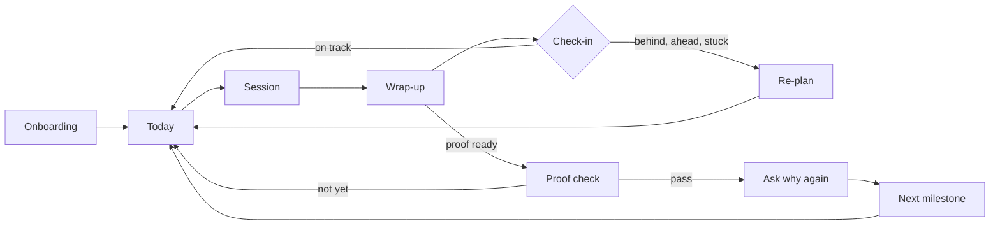

# The learning loop

How LAS teaches once onboarding is done. Covers the daily home screen, what happens in a session, how sessions are planned, teaching, drills, feedback, follow-ups, progress, and what happens when a milestone is reached.

Related: [evaluation](evaluation.md) · [MCP and data](mcp-and-data.md) · [skill packs](skill-packs.md) · [overview](../DESIGN.md) · clickable: [`prototypes/app`](../../prototypes/app/index.html) (session 1, Today, Progress)

---

## 1. Today

The home screen answers one question: **what should I do now?**

| Card | Shows | Action |
|---|---|---|
| Next session | Title, length (fits today's time slot), what it works on ("Hips close to the wall") | Start |
| Reviews due | Count and time ("6 cards · 2 min") | Review |
| Milestone | Mini route, % to the next step, proof date | Open progress |
| Check-in | Only when something needs a decision ("Missed Tuesday. Move it to today?") | One-tap answers |
| This week | One dot per planned session: done, missed or upcoming | — |

**States the screen must handle:**
- first day;
- normal;
- missed a session;
- behind schedule;
- proof ready;
- milestone done;
- paused (injury or holiday).

The weekly dots replace a daily streak. Missing a day never resets anything.

## 2. What happens in a session

A session's length comes from the plan (10–60 min). It's built from blocks with fixed roles:

| Block | Job | Share of time | Content |
|---|---|---|---|
| Warm-up | Physical skills only. Required when an injury is flagged | 10–15% | Pack-defined routine |
| Recall | Bring back items due for review | 10–15% | Quiz cards, play from memory, name the move |
| Learn | **One** new idea, shown visually | 15–20% | Teaching cards (§4) |
| Practice | Guided repetitions with instant feedback | 35–45% | Drills (§5) |
| Perform | One real attempt, analyzed | 15–20% | Record audio or video, write code, upload work |
| Wrap-up | What changed, what's next | ~5% | Before-and-after card, next session |

**Rules**
- One new concept per session. New material starts only once its prerequisites reach 60% mastery.
- Practice should feel hard but doable: aim for a 70–85% success rate. Difficulty adjusts within the session: up one level after 3 successes in a row, down one after 2 misses.
- **Closing the loop:** a correction from Perform leads to a targeted drill and a second attempt in the same session whenever time allows.
- Learners can stop and resume later the same day.
- "Short on time?" offers a 5-minute session: recall plus one drill.
- At the gym, studio, or desk: the learner's location picks which drills are possible (a hangboard drill needs a hangboard).

## 3. Session planner

The planner is deterministic and can explain itself. Every block carries a reason the learner can tap to see ("Your last clip showed your hips drifting out on 4 of 6 moves").

**Inputs**
- the route to the current milestone;
- the skill graph and how well each skill is known (BKT);
- reviews that are due (FSRS);
- unresolved mistakes;
- the planned practice mix against actual minutes over the last 2 weeks;
- injuries, equipment and location;
- time available today.

**Steps**
1. **Candidates:** skills on the path to the milestone whose prerequisites are met, plus skills with unresolved mistakes.
2. **Score each candidate:**
   `score = 0.35·(1 − mastery) + 0.25·mistake(severity × recency) + 0.2·mix gap + 0.2·milestone relevance`.
   Candidates are dropped if they conflict with an injury, need equipment the learner doesn't have, or were the main focus of the last session.
3. **Pick:**
   - Learn: the lowest-mastery skill that hasn't been started and has its prerequisites.
   - Practice: the top 1–2 by score.
   - Recall: reviews that are due, capped to fit the time.
4. **Choose drills** that fit the location and equipment. Set the starting difficulty from mastery.
5. **Perform:** usually the practiced skill's assessment. It becomes a **proof rehearsal** once every skill the milestone depends on is at 80% mastery or more.

The weights are starting values, and every planner decision is logged so they can be tuned later.

## 4. Teaching cards (Learn)

A lesson is 1–5 cards. **Each card has at most 25 words.** The server rejects specs over budget, so long text can't get through.

| Card | Pattern | Example |
|---|---|---|
| `predict` | Ask before revealing (as Brilliant does). The first card whenever possible | "Which hip position puts less weight on your arms?" |
| `sim` | Sliders or dragging, with a live readout | Hip distance from the wall → arm load % |
| `mechanism` | anatomy figure, cached per concept | How a guitar string's pitch changes with fret length |
| `diagram` | Mermaid or D3 | Sentence order: subject → verb → object |
| `demo` | Reference clip with a pose ghost, notation playback, or code trace | Step-by-step `for` loop with a variables panel |
| `compare` | Good vs bad side by side; tap the difference | Bent arms vs straight arms on the same hold |
| `try-it` | A small action inside the card | Tap the rhythm, say the word |

The agent can call `render_lesson` for questions that come up in chat ("why do my forearms burn?"). The same card types and word budget apply.

## 5. Drills (Practice)

Every drill type reports the same kind of result: `{nodes, success, score, metrics, mistakes}`.

| Type | Learner does | Scored by | Gets harder by |
|---|---|---|---|
| `choice` | Picks an answer (also listen-and-choose) | Key | More distractors, faster |
| `match` / `order` | Pairs or sequences items | Key | More items |
| `hotspot` | Taps a spot on a diagram or video frame | Region | Smaller regions |
| `predict-output` | Says what code will do | Key | Longer code |
| `fill` | Completes a phrase or a line of code | Key or tests | Fewer hints |
| `tap-rhythm` | Taps a pattern | Timing (ms) | Tempo |
| `play-along` | Plays over a metronome or backing track | Pitch and timing evaluators | Tempo, longer passages |
| `say-it` | Shadows or answers out loud | Speech evaluator | Longer sentences, natural speed |
| `move` | Does reps on camera | Movement evaluator | Harder holds or poses, more reps |
| `timed-reps` | As many as possible in 60 s (e.g. chord changes) | Count plus quality | Target count |
| `build` | Writes code against hidden tests | Tests | Harder tests |
| `make` | Uploads finished work | Rubric plus coach review | Rubric level |

Performance drills show live meters while the learner works: a pitch needle, beat dots, a pose overlay, or a test list that turns green as tests pass.

## 6. Feedback and correction

1. **One fix at a time.** Pick the top mistake (severity × confidence × frequency). Show that one fix, plus one thing they did well.
2. **Show the evidence:** the video frame, the bar of music, the line of code. Never give a correction without it.
3. **Fix, drill, try again:** every correction links to a fix drill, then a second attempt.
4. **Measure against themselves.** Compare to the learner's own past attempts, never to other people.
5. **Unsure means ask, not guess.** If the evaluator isn't confident, ask for a better recording ("I couldn't see your feet. Move the phone back a step") instead of giving feedback.
6. **Learners can push back.** "That's wrong" marks the mistake as disputed for that attempt and records it for tuning.

**A feedback card:** a headline of 8 words or fewer, the evidence visual, a **Try this** button that opens the fix drill, and an optional **Why?** that shows a visual explanation, not text.

**How a mistake progresses:** detected → coached → improving → resolved (absent in 3 attempts in a row). If it comes back later, it's reopened as resurfaced.

## 7. Follow-ups, check-ins and re-planning

| Check-in | Trigger | What it offers |
|---|---|---|
| Session reminder | Planned time, inside the learner's chosen window | Start · snooze · quick 5-min |
| Missed session | Next morning | Move it · quick session · skip |
| Plan check | 2 misses in one week | Change days or minutes, or keep as is |
| Weekly review | A fixed day, 5 min, run by the agent with visuals | Progress vs plan, practice mix, top mistake, next week |
| Proof ready | Milestone skills at 80% mastery or more, and 2 recent attempts passing | Take the proof check |
| Plateau | Key metric flat over 4 sessions | Variation, a lighter week, or "what's getting in the way?" |
| Pain reported | Any session | Lower intensity now. Suggest seeing a professional if it lasts more than a week |
| Gone quiet | 14 days with no session | Ask the why question again. Offer a smaller goal or a pause. No guilt |

**Re-planning**
- **Velocity** = ladder hours gained per week (from mastery) compared with the plan.
- **Behind** (projected date more than 20% past the target): offer a stepping stone, more time, or a later date.
- **Ahead** by more than 30%: offer a stretch goal.
- The learner always chooses, and the choice is logged. The plan never changes silently.

**Delivery:** an MCP server can't start a conversation, so check-ins go out through:
1. the client's own scheduled tasks, where it has them;
2. Web Push from the studio;
3. optional email from a self-hosted mail server.

**Limits:** quiet hours, at most 1 nudge a day and 4 a week, and one-tap pause.

## 8. Progress

- **Route map:** the ladder, with a mastery ring for each skill inside each step.
- **Key metrics:** 2–3 per pack, each with a trend line. For example, guitar chord changes per minute; bouldering straight-arm ratio; Spanish pronunciation score; Python first-try pass rate.
- **Before and after:** the first saved attempt beside the latest attempt at the same drill. Video and audio are shown side by side.
- **Time:** actual minutes against the plan, and the practice mix actual vs planned.
- **History:** sessions, attempts and feedback.

There are no leaderboards. The only comparison is with your own past.

## 9. Proof check and the next milestone

1. **Checklist:** the milestone's proof standard, broken into criteria ("2 different V2s", "hips close to the wall").
2. **Record:** guided, in one continuous take. Audio and video are recorded in the app; code runs in the sandbox.
3. **Result per criterion,** with evidence.
4. **Pass:** a celebration and a **proof card** (an image or clip the learner keeps and can share), then the **why** and six-month questions again, then the next milestone. The next milestone uses the onboarding milestone screen with the updated ladder.
5. **Not yet:** shows which criterion missed and adds targeted work to the next sessions. The learner can retry any time; the app suggests waiting until a rehearsal passes.
6. **"I did it outside the app":** the learner can mark it done themselves. It's flagged as self-reported and proof stays optional. The system trusts the learner by default.

## 10. Motivation

| Use | Avoid |
|---|---|
| Weekly consistency dots | Daily streaks that punish one missed day |
| Before-and-after comparisons, proof cards | Leaderboards |
| Copy that ties back to their own why ("one step closer to the campfire") | Guilt copy, countdowns |
| Pausing as a normal choice | More than 1 nudge a day |

## 11. Example first sessions

| Pack | Plan | Learn | Practice | Perform → feedback |
|---|---|---|---|---|
| Bouldering, V1 → V2, 45 min at the gym, sore fingers | 8-min warm-up with open-hand grips (because of the injury) | `predict` and `sim`: hip distance from the wall vs arm load | Silent-feet traverse ×3; hips-in on three V0s | Film one V2 attempt → "Hips drift out on moves 3–5" with a hip-line overlay → fix drill: hips-in on that problem → second attempt |
| Guitar, full song → strumming, 30 min | Recall: play G, C and D from memory (audio check) | `demo`: D DU UDU pattern with animated arrows and play-along | Tap the pattern, then strum muted at 60 bpm, adding 4 bpm every 3 clean bars | Record 4 bars → "Upstrums rush by about 60 ms" on a beat timeline → fix drill: upstrums only, with a click |
| Spanish, brand new → survival, 20 min | — | `compare`: picture menu with "Quisiera ___, por favor" | Listen and choose; `say-it` shadowing with a pronunciation score | Voice role-play ordering food with the coach as the waiter → "Your 'e' in *cuenta* slides into 'ay'" with a per-vowel score → shadow 5 words |
| Python, loops → CLI tool, 45 min | Recall: 3 predict-output cards | `demo`: code trace of a function returning a value | `fill` and `predict-output` | Write `count_words()` against hidden tests → "Fails on an empty file" with a test diff and a trace → fix, run again |
