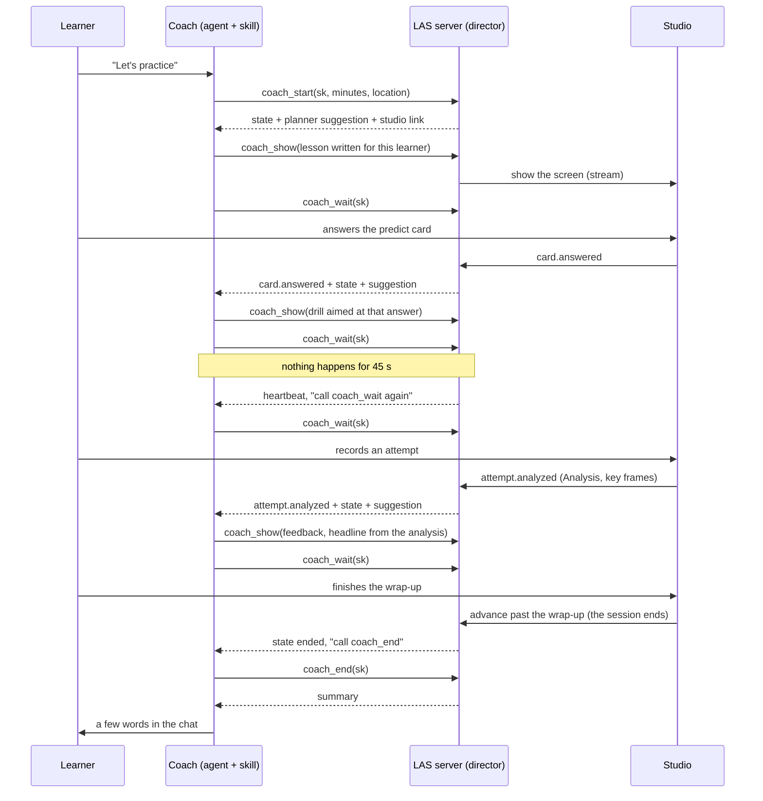
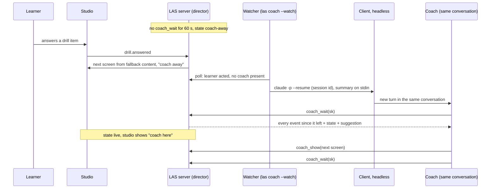
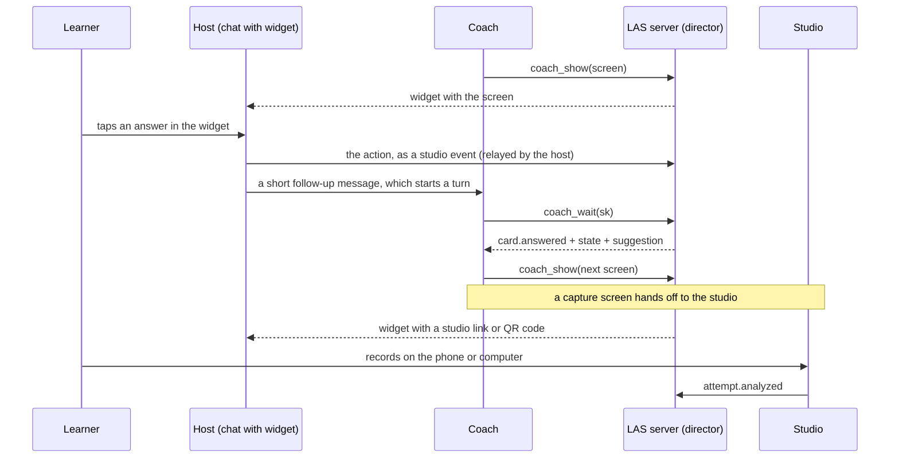
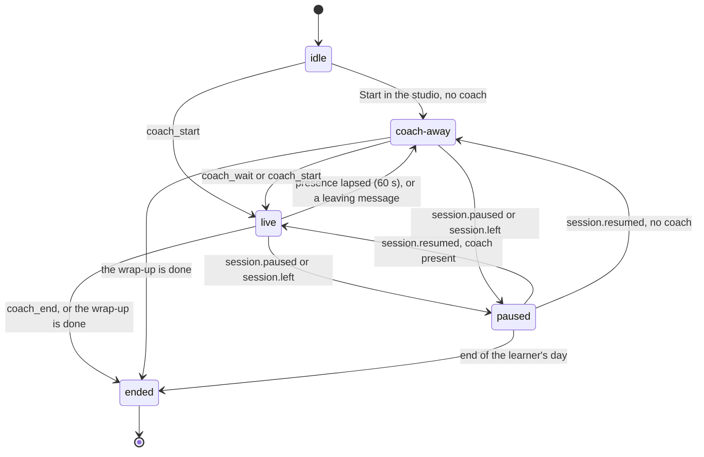

# The live coach

How the agent stays present during practice and writes each next screen for this learner, at this moment. Covers the coach loop, the watcher that brings a coach back, MCP Apps widgets, the events and screens, the session director, the fallback, timeouts, cost, privacy, failure modes and tests.

Related: [learning loop](learning-loop.md) · [MCP and data](mcp-and-data.md) · [skill models](skill-packs.md) · [evaluation](evaluation.md) · [any skill](any-skill.md) · [overview](../DESIGN.md) · clickable: [`prototypes/app`](../../prototypes/app/index.html) (session 1 shows the screens a coach writes; in the prototype they are pre-written)

Status: **built in v0.2** ([build plan](../DESIGN.md#13-build-plan)). First client: **Claude Code**. Where the build differs from the first design, this page now describes the build.

**Not done yet:**

- `plan` screens outside a live session (a coach-worded check-in on Today and in the notification), and the watcher waking a coach for a due check-in (§10).
- Latency tests with a real clock (§11, §16).
- `CoachSuggestion.fallbackScreenId`: in the type, never set.
- A route to dismiss a coach message: the studio hides it on that device only.
- The widget's coach view is read-only: it shows the screen and a studio link (§5).
- `learner.hesitated` is unit-tested, not in the end-to-end tests.
- The `/las-session` prompt still asks for the v0.1 flow (`next_session`); the skill tells the agent to use the loop.
- `las-agents serve` tries the studio port once at start-up; only `las coach --watch` retries it (§14).
- No OS notifier on Windows; Web Push still works there.

---

## 1. The problem

**In v0.1** the agent wrote the whole session up front. The skill model held every lesson card, drill item and feedback headline. The studio ran the session with no model in the loop. The agent came back only when it called a tool (`next_session`, `get_analysis`, `get_session_summary`).

**From v0.2** the agent is a **live coach**. It watches the learner move through the screens and writes each next screen for this learner, now: a lesson that uses the wrong answer they just gave, a drill aimed at the mistake in the clip they just recorded, a short answer to the question they just typed.

**The constraint.** An MCP server can't start a turn in the agent. Only the client can. So LAS needs a way to keep the agent's turn open, or to start a new one from outside. Three mechanisms, in priority order:

| # | Mechanism | How the agent hears about the learner | Clients | When |
|---|---|---|---|---|
| 1 | **Coach loop** in one conversation | `coach_wait` blocks until something happens in the studio | Any client that allows a tool call of about a minute; Claude Code first | Default |
| 2 | **Watcher** re-wakes the coach | `las coach --watch` resumes the same conversation headlessly | Claude Code (verified); Codex, OpenCode, Goose rows exist but are unverified; other clients get a notification | When the loop broke or the coach left |
| 3 | **MCP Apps widget** in the chat | The widget relays the learner's action through the host | Hosts that render MCP Apps | Second route; the v0.2 widget is read-only (§5) |

**When no coach is reachable**, the session still runs. The studio shows "coach away" and serves the content the agent wrote at model time (§9). Sessions never block on a model.

## 2. Who does what

| Part | Job | Never does |
|---|---|---|
| **Coach** (the agent, guided by the skill) | Reads events and state; writes the next screen; answers questions in a few words; proposes plan changes | Grades raw media; changes the plan silently; writes outside the budgets |
| **Session director** (`packages/server/src/core/director.ts`; screen checks in `core/coach-screens.ts`) | Holds the live session's state in the store; queues events for the coach; validates and shows screens; applies the presence rule; shows the warm-up and recall; serves fallback screens | Decides what to teach while a coach is present |
| **Planner** (`core/planner.ts`) | Scores candidates as before and **suggests** the next item with its reason | Has the last word while a coach is present |
| **Engines** | Measure, as before. The only source of numbers | Write words for the learner |
| **Studio** (PWA, `packages/studio/src/live`, `screens/live.tsx`) | Shows screens, sends learner actions as events, shows "coach here", "coach away" or "thinking", hosts the ask-the-coach box and Pause | Talks to the agent directly |
| **Watcher** (`las coach --watch`, `packages/cli/src/coach.ts`; client table `adapters.ts`) | Notices learner actions with no coach present and resumes the coach's conversation, or notifies the learner | Coaches; it only wakes |

Every rule in the learning loop still holds: one new idea per session, 70–85% success, one fix at a time, nothing changes silently, pain means stop ([learning loop](learning-loop.md)). Principle 5 is unchanged: engines measure, the coach writes the words around the numbers.

## 3. Mechanism 1: the coach loop

The agent's turn stays open for the whole session. It loops: wait, decide, show, wait.



### 3.1 The four tools

| Tool | Input | Output |
|---|---|---|
| `coach_start` | `sk, minutes?` (5–120), `location?, client?, clientSessionId?` | `{liveSessionId, sk, skill, reattached, state, plan, suggestion?, studioPath, instruction}`. Plans the session (`plan` = title, minutes, focus, blocks with reasons: advice), creates the `live_session` row, shows the warm-up or recall if the plan starts with one. Re-attaches when this LAS process already holds the session; takes it over when the holder is away; refused while another holder is present (§8). Refused for a paused skill. A live session left open from an earlier day with no coach present ends first |
| `coach_wait` | `sk, timeoutS?` (default 45; anything above 55 is cut to 55), `ack?` | `CoachWaitResult` (§3.2). Blocks until events arrive, the learner is waiting for a screen, the session ends, or the timeout (a heartbeat). Like `coach_start`, it takes over a session whose holder is away, so a resumed coach can begin with it |
| `coach_show` | `sk, screen` (§7), or `"suggested"` | `{ok, errors[{path, message}], screenId?, status: "shown" \| "queued", current?, instruction}`. A rejection comes back as a tool error and nothing is shown. Needs the session: a process that doesn't hold it gets "You don't hold this session. Call coach_start first." |
| `coach_end` | `sk` | `{liveSessionId, sk, summary, instruction}`. Shows the fallback wrap-up first if the coach didn't show one, ends the session and returns the `SummaryView`. For a session that already ended it returns the stored summary |

`clientSessionId` is the client's own conversation id. It is optional: on Claude Code the SessionStart hook already recorded it and `coach_start` finds it (§4.1). A passed `clientSessionId` wins; the hook file is looked up only when none is passed. `client` is the client id from `clients.ts`; when it's missing, the hook file's client is used.

Every result carries `instruction`, the next step for the agent. Errors do too.

### 3.2 What `coach_wait` returns

```ts
interface CoachWaitResult {
  liveSessionId: string;             // = the session's id
  sk: string;
  events: CoachEvent[];              // in id order; empty on a heartbeat
  heartbeat?: true;
  state: {
    state: "live" | "coach-away" | "paused" | "ended";
    block: BlockKind; step: number;  // screen index inside the block
    minutesUsed: number; minutesPlanned: number;
    screen?: { id: string; kind: ScreenKind; source: "coach" | "fallback"; shownAt: string };
    queued?: { id: string; kind: ScreenKind };
    mastery: { nodeId: string; name: string; before: number; now: number }[];   // up to 12 changed nodes
    mistakes: { id: string; state: string }[];                                  // unresolved, or seen this session; up to 10
    difficulty: Record<string, number>;                                         // this session's level per drill
    intensityCap?: number; injuries: string[]; location?: string;
    studio: { connected: boolean; lastSeenAt?: string };                        // connected: heard from in the last 75 s
    holder?: { client?: string; present: boolean };
    waiting?: { since: string; until: string };  // the learner finished a screen, nothing is queued: the fallback shows at `until`
  };
  suggestion?: { item: SessionItem; block: BlockKind; reason: string; fallbackScreenId?: string };  // fallbackScreenId: never set yet
  instruction: string;
}
```

`ScreenKind` is the seven coach kinds plus the director's own `warmup`, `recall` and `pause`. The state is kept small (about 2 KB of JSON) so long sessions don't flood the context. Full views stay one tool call away (`get_progress`, `get_analysis`).

**When it returns, and what it says**

| Returns because | `instruction` |
|---|---|
| Events are waiting (after a 300 ms window, so a burst arrives together) | By the events: paused or left: "Call coach_wait again; queue the next screen if you like, it shows when they come back." `pain.reported`: "Show a short message, then an easier screen or coach_end; suggest a professional if it continues." `learner.asked`: "Answer the question in a short message (coach_show kind message, replyTo its id), then back to practice." Otherwise: "Read the events (skip ids you've seen), show the next screen with coach_show (or "suggested"), then call coach_wait again." |
| The learner finished a screen and nothing is queued (once per wait; `state.waiting` is set) | "The learner finished the screen and is waiting: show the next screen now (coach_show), before `<until>`, then call coach_wait." |
| The session ended | "The session ended. Call coach_end for the summary, then say a few words to the learner." |
| `timeoutS` passed with nothing new | `heartbeat: true`: "Nothing happened. Call coach_wait again now; don't reply in the chat." |
| The client cancelled the call | "Cancelled. Call coach_wait again." |

Errors: "No live session for this skill. Call coach_start first." and "Another coach took over this session (`<client>`). Stop the loop: tell the learner in a few words."

**Delivery.** Events are delivered in order, at least once, with rising numeric ids. The next `coach_wait` acknowledges the batch the last one returned (it sets `delivered_at`). With `ack: "<id>"` it acknowledges only up to that id, so a coach whose reply was lost (the client timed out) passes the last id it handled and gets the rest again. A call the client cancelled acknowledges nothing. The coach skips ids it has already handled.

## 4. Mechanism 2: the watcher

`las coach --watch` watches the event queue. When the learner acts and no coach is present, it resumes the coach's conversation headlessly. The resumed coach calls `coach_wait`, gets everything that happened while it was away, and picks up the loop. Its LAS process is a new one, so that first `coach_wait` takes the session over (§8).



**How it runs.** `las coach --watch [--interval <s>] [--no-studio]` reads the store every 3 s (the `coach.watchPollS` setting) and keeps running. `las coach --once` does one pass and exits, for cron, like `las checkin`. Without `--once` it also serves the studio while the port is free, and tries again every 5 s when another LAS process holds it, so the studio stays up after the coach's client exits (§14). Log lines go to stderr and never carry learner text.

**The summary it sends** names the skill, the `sk`, the live session and the event types with counts, then says: "Call coach_wait with sk `<sk>` now. It returns everything that happened, the state and the planner's suggestion. Then keep the coach loop going (coach_wait, coach_show) until coach_end. Use LAS tools only." It never carries the learner's typed text or any analysis; the coach reads those through `coach_wait`. It goes on stdin, not the command line, so it doesn't show in the process list (OpenCode is the exception, §4.1).

**When it wakes a coach**

- only for sessions in `coach-away`, or `live` with the presence window run out. The watcher counts a coach as present while a wait is open and the holder's process lives, or a wait returned less than 60 s ago;
- only for pending learner actions: `screen.viewed`, `card.answered`, `drill.answered`, `attempt.analyzed`, `learner.asked`, `pain.reported`, `session.resumed`, `plan.chosen`. Never for `learner.hesitated`, `session.paused` or `session.left`;
- at most one wake in flight per live session, also across watcher processes (`$LAS_HOME/coach/wakes/<id>.json` holds the child's pid); at most one every 2 minutes; at most 5 per session (settings `coach.wakeMinIntervalS`, `coach.wakeMaxPerSession`). A notification counts as a wake. The wake is claimed before the child starts, so cron and `--watch` together still keep the interval;
- never after the coach left on purpose with a `leaving` message (§15), until a `learner.asked` is pending;
- **never into a conversation that is still open in an interactive client.** The director records the process id of the LAS server that holds the coach (`live_session.coach_pid`). If that process is alive, the client is open. Claude Code's resume doesn't fork: it keeps the id, and both windows write into one transcript, interleaved. So this alive-pid rule is what makes a headless resume safe. The watcher sends a notification instead ("Your coach is waiting in Claude Code").

It also notifies instead of resuming when the client has no headless mode, no client or no conversation id was recorded, or the command can't be started. The resumed client runs detached, in the folder the hook recorded (`cwd`) when it still exists. Its stdout goes to a file; the next pass reads it even when no watcher was listening when it exited, and stores a new conversation id if the client reports one.

**Notifications** go through the adapter's channel: `push` tries the studio's Web Push, then the OS notifier (`notify-send` on Linux, `osascript` on macOS; none on Windows yet); `os` uses the OS notifier only. The text is the adapter's fixed line, never learner text. A tap opens `/app/session/<id>`.

### 4.1 Adapters: one row per client

Like the code runners' language table (`packages/runners/src/languages.ts`) and the setup CLI's client table (`packages/cli/src/clients.ts`), each client is one row in `COACH_ADAPTERS` (`packages/cli/src/adapters.ts`). Client ids match `clients.ts`.

| Client | Headless command | How the session id is captured | When it can't be resumed |
|---|---|---|---|
| `claude-code` (verified) | `claude -p --resume <id> --allowedTools "mcp__las__*" --output-format json`, summary on stdin | 1. The `clientSessionId` the agent passed. 2. Else the SessionStart hook's file: `las-agents setup` installs the hook, which writes `$LAS_HOME/clients/claude-code/<pid>.json` = `{sessionId, client, pid, cwd, at}` keyed by Claude Code's pid; on `coach_start` the LAS server walks its parent processes (`/proc` on Linux, `ps` elsewhere, one PowerShell call on Windows) and takes the nearest ancestor's file. 3. After each headless run the watcher stores the `session_id` from the JSON output if it changed | Push, then OS notification: "Your coach is waiting in Claude Code" |
| `codex` | `codex exec --json resume <id> -`, summary on stdin | ⚠ open: the agent's `clientSessionId` only; ⚠ the `--json` event that carries the thread id | Push, then OS |
| `opencode` | `opencode run --session <id> <summary>`: stdin isn't documented, so the summary goes on argv (it carries no learner text) | ⚠ open | Push, then OS |
| `goose` | `goose run --resume --name <name> --instructions -`, summary on stdin | ⚠ open: the session name | Push, then OS |
| `claude-desktop` | none: no headless mode | not needed | OS notification: "open it and type /las-session". ⚠ open: whether it can open the app with `/las-session` prefilled |
| `cursor`, `continue`, `cline` | none known ⚠ | not needed | OS notification |

**Verified for Claude Code** (2026-10-13, Claude Code 2.1.296 and its docs; the full notes are in the header of `adapters.ts`):

- `claude -p --resume <id>` keeps the session id and appends to that transcript; only `--fork-session` makes a new id. With the same conversation open in an interactive window, the messages of both interleave into one transcript. Hence the alive-pid rule above. A running background session (`claude --bg`) makes the resume exit with status 1; the watcher logs a failed wake.
- The SessionStart hook gets JSON on stdin with `session_id`, `transcript_path`, `cwd`, `hook_event_name` and `source` (`startup`, `resume`, `clear`, `compact`, `fork`). The command runs under `sh -c`, so `$PPID` in the command string is Claude Code's pid (checked by running it). The hook command is `las-agents client-session --client claude-code --pid $PPID`. It prints nothing, because a SessionStart hook's stdout is added to the context, and it deletes files older than a day. On Windows setup leaves out `--pid` and the subcommand walks its own parents (⚠ not run on Windows).
- `--allowedTools "mcp__las__*"` matches every tool of the `las` server. The flag is variadic, so another flag always follows its value.
- `--output-format json` returns one object with `session_id`, `is_error`, `result` and `total_cost_usd`.
- The resume command was checked against the docs, not run in the build container (a test resume could write into that container's own live session).

**Permissions.** A coach resumed in Claude Code may call LAS tools only (`--allowedTools`). It can't run shell commands or touch files without the learner. ⚠ The Codex, OpenCode and Goose commands have no such limit, which is one reason those rows stay unverified.

**When nothing can be resumed** the session keeps going on fallback content, the studio keeps showing "coach away", and the notification tells the learner where the coach is waiting. Nothing is lost: the events wait in the queue.

## 5. Mechanism 3: MCP Apps widgets

Where the host renders [MCP Apps](https://github.com/modelcontextprotocol/ext-apps), the four coach tools return the `coach` view, and the widget draws the current screen in the learner's theme, inside the chat.

**Built in v0.2:** the widget's coach view is **read-only**. It shows the screen, the presence pill, a message and the summary, with a link to the studio, where the learner works. The design below is not built yet.



- Cards, knowledge drills, feedback, messages, plan options and the wrap-up would work inside the widget.
- **Camera and microphone work hands off to the studio** (a link, or the QR code for the paired phone). The analysis comes back as `attempt.analyzed` as usual.
- ⚠ Open: which hosts let a widget start an agent turn, and whether the widget's action reaches the server as a tool call or through the studio's `POST /api/events`.

## 6. Event catalogue

Events the coach receives from `coach_wait` (`CoachEventSchema`, `packages/schema/src/coach.ts`). Each has `{id, type, at, screenId?}` plus the payload below. The studio sends its events through `POST /api/events`; the server logs them in `event`, adds its own reaction, then queues them.

| Event | Payload | Fires when |
|---|---|---|
| `screen.viewed` | `kind, source` (`coach` or `fallback`), `previous?: {screenId, kind, seconds}` | The studio shows a screen. The studio sends the screen id and the seconds on the previous one; the server adds the kinds and the source |
| `card.answered` | `card` (index), `cardType, answer, correct?, seconds?` | The learner answers a `predict`, `compare` or `try-it` card |
| `drill.answered` | `drillId, itemId?, correct?` or `success?, score?`, `difficulty, changed` (`up`, `down`, `none`), `mastery: {nodeId, before, after}[], done, outcome?` | Each knowledge item (`POST /api/drill/:id/next`, `done: false`), and each `drill.outcome` (`done: true` with the full outcome) |
| `attempt.analyzed` | `attemptId, drillId?, analysis` (no overlay data), `keyFrames` (up to 3 `{t, ref, label?}`), `proof?` (the `ProofResult`), `top?: {mistakeId, name, confidence, severity?, fixDrillId?}` (the server's top-mistake pick, as advice) | The engine finishes an attempt. **Never media:** an inline frame becomes the reference `attempt:<id>/frame/<i>`; with no key frames, the first 3 markers give `attempt:<id>@<t>` |
| `learner.asked` | `text` (up to 280 characters) | The learner types in the ask-the-coach box |
| `learner.hesitated` | `seconds` (20) | 20 s on a screen with no action. Once per screen (the studio and the server both check). Not during a recording, a pause or a wait for the coach |
| `pain.reported` | `area, level` (1–5), `intensityCap` (the cap the server just applied) | The learner reports pain. The server lowers intensity first, as in v0.1; a queued drill above the new cap is dropped; when the level stops practice for today, the fallback goes to the wrap-up |
| `session.paused` | `reason` (`learner`, `pain`) | The learner taps Pause. The studio shows the pause screen |
| `session.resumed` | `pausedSeconds` | The learner taps Resume and gets the screen they paused on |
| `session.left` | `reason` (`closed`, `studio-offline`) | The page closes (a beacon from the studio), or the server hasn't heard from the studio for 5 minutes. Either way the session pauses |
| `plan.chosen` | `optionId, label, change` (what the server changed, in words) | The learner tapped an option on a `plan` screen; the server has already applied it (§10) |

A **heartbeat** is not an event: `coach_wait` returns `heartbeat: true` with no events. It is never stored.

**Studio events** (`StudioEventSchema`, `packages/schema/src/events.ts`), each with `sessionId`: `screen.viewed {screenId, previous?: {screenId, seconds}}`, `card.answered {screenId, card, cardType, answer, correct?, seconds?}`, `learner.asked {screenId?, text}`, `learner.hesitated {screenId, seconds}`, `session.paused {reason}`, `session.resumed {pausedSeconds}`, `session.left {reason}`, `plan.chosen {screenId, optionId}`. `drill.answered` is made by the server. `attempt.analyzed` and `pain.reported` already existed.

**Not coach events:** `review.graded`, `block.completed`, `attempt.captured`, `attempt.disputed` and `checkin.answered` still update the learner model as before. They show up in the next state, not as their own events. ⚠ Open: should `attempt.disputed` wake the coach?

## 7. Screen catalogue

What `coach_show` accepts (`CoachScreenInputSchema`). Each screen resolves into a view the studio and widget already draw (`packages/schema/src/views.ts`), so live screens and fallback screens look the same.

| `kind` | The coach writes | The server adds | View it renders as |
|---|---|---|---|
| `lesson` | `title, nodes` (1+), `cards` (1–5 of the standard types), `reason?` | Validation, figure rendering | `SessionItem` `lesson` (id `coach.<screenId>`) |
| `drill` | `drillId` (a scaffold drill), or a knowledge drill of its own: `type` (`choice, match, order, hotspot, predict-output, fill`), `nodes, items` (up to 12); `title?, prompt?, difficulty?` (a level index of that drill), `reason?` | Starting difficulty (the coach's level becomes the session's level for that drill), items served one by one, grading by key or engine. Own items get the drill id `coach.<screenId>`, intensity 1 | `SessionItem` `drill` |
| `capture` | `drillId` (a performance drill with a validated spec) or `milestoneId` (the active milestone), `prompt?, how?, reason?` | The attempt (a proof once the learner is ready, else a rehearsal), the capture spec, the studio or phone link | `SessionItem` `capture` |
| `feedback` | `attemptId, headline, evidence` (`{kind: "mistake", mistakeId}`, `{kind: "marker", index}` or `{kind: "metric", metricId}`), `fixDrillId?, why?: {figure?, card?}, praise?` | The analysis, the evidence visual, the fix drill (the mistake's own when none is given), precision; marks the mistake coached. An empty headline falls back to the mistake's headline or name | `SessionItem` `feedback` with a `FeedbackView` |
| `message` | `text, figure?, replyTo?` (an event id), `leaving?` | — | **New** `CoachMessageView`, shown over the current screen |
| `plan` | `question`, 2–4 `options` (`{id, label, detail?, action}`; `action` is `replan {option}`, `reschedule {days?, minutesPerWeek?, targetDate?}`, `checkin {option}` or `none`), `reason` (required, shown to the learner), `checkinId?` | Applies the option the learner taps and logs it as a plan change (§10) | **New** `PlanProposalView` |
| `wrapup` | `praise?, oneFix?, nextNote?, reason?` | What changed, the metric, the next session: the server's `SummaryView` with the coach's words over it (`nextNote` is new) | `SessionItem` `wrapup` with `summary` |

The director makes three kinds of its own: `warmup`, `recall` and `pause` (`SessionItem` `pause {pausedAt}`).

**Shortcut:** `coach_show(sk, "suggested")` shows the planner's suggestion with its pre-written content. It is rejected when nothing is left ("Show a wrapup screen or call coach_end.") or when the suggestion has no pre-written content, such as a lesson with no cards ("Write that screen yourself (for a lesson: kind lesson with its nodes and 1–5 cards), then call coach_wait.").

**Warm-up and recall stay scaffold.** The warm-up comes from the model's safety fields and is never rewritten live. Recall shows the FSRS cards that are due. The director shows both itself (`source: fallback`), before any queued coach screen, and the suggestion never names them. The coach may add a `message` around them.

**What `coach_show` checks** (the same checks `validate_skill_model` runs, applied to one screen; no side effects until it passes):

- **word budgets:** cards 25; drill and capture `prompt` and `how` 25; knowledge items 40 (prompt and text together); feedback `headline` and `praise` 8; wrap-up `praise` and `oneFix` 8, `nextNote` 25; `message` 25; plan `question` 25. The schema also caps string lengths;
- **types:** only the standard card types (`predict, sim, mechanism, diagram, demo, compare, try-it`), with the sim spec checks; a drill with its own items must be a knowledge type; an engine-measured `type` is refused ("name a scaffold drill (drillId) instead"); the keys `spec, specs, metrics, metric, detector, engineSpec` on a drill or capture are refused: specs are written at model time only;
- **references:** nodes, drills, the milestone (active, with a proof), the attempt (this learner's, analyzed), the evidence in that analysis, `fixDrillId`, `replyTo` (an event of this session), `checkinId` (an open check-in of this learner), unique item and option ids, a `difficulty` within the drill's levels, a knowledge drill without pre-written items needs the coach's own;
- **plan options:** a `replan` option is one of `stone, smaller, more-time, later-date, stretch, keep, change-days, change-minutes, pause, resume` (with `:value` where one is needed); a `reschedule` sets at least one field, with a `YYYY-MM-DD` date and an active milestone for `targetDate`; a `checkin` option needs `checkinId` and one of that check-in's answers;
- **evidence:** a mistake at or above its floor (the model's `min_confidence`, default 0.7) and not disputed on this attempt; a metric at or above 0.7; a marker index that exists. A failed quality check means a re-record, not feedback. One fix per feedback screen: `fixDrillId` is the mistake's fix drill or a drill that `fixes` it;
- **measurement:** a performance drill or capture uses a drill with a validated spec (a `tap-rhythm` drill needs none);
- **safety:** nothing above the intensity cap; nothing that needs equipment the learner doesn't have at this location; nothing that conflicts with an injury (a drill in a `hard_focus` category at intensity 3 or more while an injury is flagged; the error quotes the model's rule for that injury); nothing on the built-in supervised-only list or the model's `safety.supervised_only`;
- **reason:** a `lesson`, `drill`, `capture` or `wrapup` screen that differs from the suggestion needs a `reason` (§10). `feedback`, `message` and `plan` never need one as an override; they answer what just happened (a `plan` carries its own required `reason`, shown to the learner).

**Rejection.** Every error comes back at once as `{path, message}`, in a tool error that starts "Rejected, nothing shown:" and ends "Fix these and call coach_show again; the learner keeps the current screen (the fallback shows after the screen deadline)."

**Showing.** A `message` shows at once, over the current screen. Every other kind shows at once when the learner is waiting (finished a screen, nothing queued) or has no screen yet; otherwise it is **queued** as the next screen and replaces any earlier queued coach screen. While the session is paused it is queued.

## 8. The session director

One live session per enrollment at a time. Its state is stored (`live_session`), not held in memory, because the process that serves the studio may not be the one the coach talks to (each stdio client starts its own LAS server; only one holds the studio port). Every change runs in one write transaction, so two processes never lose each other's changes.



A session still open from an earlier day ends when the next one starts, unless a coach is present.

**The presence rule.** A coach is present while it holds the session, hasn't left on purpose, and a `coach_wait` call is open or returned less than 60 s ago. An open call stops counting 115 s (60 + 55) after it began, so a process that died mid-wait runs out too. A looping coach is always present: heartbeats come back within 55 s and it calls again at once. When the 60 s run out, the session goes to coach-away and the watcher may step in.

| State | What the studio shows | Where the next screen comes from |
|---|---|---|
| idle | Today, with Start | — |
| live | The coach's screens, "coach here", the ask-the-coach box, Pause | The warm-up and recall first, then the coach's queued screen. If the learner finishes a screen and nothing is queued: "thinking", and `coach_wait` returns with `state.waiting`. After the **screen deadline** (8 s) the fallback shows, so a slow model never blocks practice |
| coach-away | "Coach away", fallback screens; the ask box still works and says the coach will answer when back | The planner's next item with the model's pre-written content |
| paused | A pause screen with Resume and the time so far | — |
| ended | The wrap-up and summary | — |

**How the studio hears.** Learner actions go through `POST /api/events`, as before. The live routes (`packages/server/src/http/live-routes.ts`):

| Route | Body | Returns |
|---|---|---|
| `GET /api/live?sk=` | — | `{live: LiveView \| null}`: the open live session for the skill |
| `POST /api/live/start` | `{sk, minutes?, location?}` | `LiveView`: a new session in coach-away (or the open one) |
| `GET /api/live/:sessionId` | — | `LiveView`; also counts as the studio arriving: it serves a first screen if there is none |
| `POST /api/live/:sessionId/advance` | `{screenId, seconds?}` | `{screen?, waiting?, until?, view}`: the next screen, or wait for a present coach until `until`. Advancing past the wrap-up ends the session |
| `POST /api/live/:sessionId/ping` | — | `{ok, coachPresent, state}`; marks the studio as seen |

The stream (`GET /api/stream`) carries four events: `coach.screen {liveSessionId, screen}`, `coach.message {liveSessionId, message}`, `coach.state {liveSessionId, state, coachPresent, queued?, leftOnPurpose}` and `coach.ended {liveSessionId, summary}`. While a studio listens, the process that serves it re-reads the open live sessions every 250 ms, so changes made by another process reach the stream, and deadlines and presence apply on time.

**What the studio does** (`packages/studio/src/live`):

- `/app/session/:id` uses the live runner when `GET /api/live/:id` answers with a live session, else the planned v0.1 runner. Today's Start calls `POST /api/live/start`; a server without the live routes gets a planned session.
- When a screen is done it calls `advance`. On `waiting` it waits on the stream for the coach's screen until `until`, then asks again and gets the fallback (up to 4 rounds).
- It sends `screen.viewed`, `card.answered`, `learner.hesitated` (20 s), `learner.asked` (the ask box, 280 characters), `plan.chosen`, and Pause and Resume. On page hide it sends `session.left` by beacon. It pings every 30 s.
- Events go through an ordered outbox, kept in memory and `sessionStorage`. While offline they wait, then go out in order. An event the server refuses (a 4xx) is dropped so it never blocks the rest.
- A coach message can be closed; that is local to the device.

**One coach at a time.** Each LAS process holds a token per live session. The same process re-attaches. While the holder is present, a `coach_start` or `coach_wait` from another process is refused: "Another coach is coaching this session right now (`<client>`). Don't start a second one…". When the holder is away, `coach_start`, `coach_wait` or `coach_end` from another process takes over: new token, `coach_pid`, `client` and `coach_session_id`. The takeover is logged as the event `coach.takeover {liveSessionId, from, to, at}`. The old holder's later calls get "Another coach took over this session (`<client>`). Stop the loop: tell the learner in a few words that the coach continues there."

**Learners stop and resume the same day,** as before. A paused session ends at the end of the learner's day and keeps what was done.

**Stored data** ([MCP and data §6](mcp-and-data.md#6-data-model-sqlite), migration 2):

```
live_session(id, enrollment_id, state, coach_session_id, client, coach_pid, coach_token, last_wait_at, wait_open,
             left_on_purpose, studio_seen_at, wakes, last_wake_at, json, started_at, ended_at)   -- id = session.id
coach_event(id, live_session_id, type, json, created_at, delivered_at)    -- the coach's event queue; id rises
coach_screen(id, live_session_id, kind, source, json, queued_at, shown_at, answered_at)   -- every screen, live or fallback
```

`coach_session_id` is the client's conversation id that the watcher resumes; `client` is the client id from `clients.ts`; `coach_pid` is the LAS process that holds the coach; `coach_token` says which process holds it; `last_wait_at` and `wait_open` drive the presence rule; `studio_seen_at` drives `studio.connected` and the 5-minute offline rule; `wakes` and `last_wake_at` are the watcher's count. `live_session.json` is the director's own state: block and step, plan items served, the current, queued and message screen ids, the wait and its deadline, the pause, the coach's own drills, mastery at the start, the last batch, takeovers and the final summary. `coach_screen.json` holds the screen, the coach's input and, for an override, its reason.

## 9. Fallback content and the skill model

The skill model is a **scaffold** plus **fallback content**. Both are written by the agent at model time, and `validate_skill_model` checks both. Details: [skill models §3.1](skill-packs.md#31-scaffold-and-fallback-content).

| | Fields | Required |
|---|---|---|
| **Scaffold** | why, pictures, probes, placement, ladder and proofs, the skill graph (nodes, prerequisites, BKT, review cards), lessons (id, title, nodes: nodes name them), drills with their types, specs, needs, success, difficulty and intensity, engine specs (an items spec that a probe or proof reads needs its items), mistakes with their detectors, names and fix drills, warm-ups and safety fields, access, injuries, focus, key metrics | Yes. Onboarding, the planner, engines and safety need them |
| **Fallback content** | lesson `cards`, drill `prompt`, the `items` of an items spec only practice drills use, mistake `headline`, mistake `explain` (the why) | Optional in the schema, checked whenever present. Defaults: `cards: []`, `items: []`, `headline: ""` (none), no `prompt`, no `explain`. The skill tells the agent to write all of it |

**The warnings.** `validate_skill_model` passes a model with gaps and returns one warning (check `fallback`) per gap:

| Gap | Warning |
|---|---|
| A lesson with no cards | "with no coach, the session skips it" |
| An items spec with no items | "with no coach, drills that use it are skipped" |
| A drill with no prompt | "with no coach, the studio shows its title" |
| A mistake with headline `""` | "the fallback feedback will use its name" |
| A mistake with no `explain`, or one pointing at a lesson with no cards | "the fallback feedback leaves out the Why button" |

**The fallback rule.** Fallback content is used only when no coach is present (presence rule, §8), or after the screen deadline when a present coach hasn't written the next screen yet. While no coach is present the studio shows "coach away" and the watcher tries to bring the coach back. A screen served after the deadline is recorded with `source: fallback`, so the coach sees it in its next `coach_wait`.

**What the fallback shows next:** the wrap-up when time is up or pain stopped practice; else the feedback card for an attempt analyzed in this session that has none yet (the server's top-mistake pick); else the next plan item it has content for; else the wrap-up.

**When fallback content is missing** the director never invents text. It skips the item (a lesson with no cards, a knowledge drill with no items) and moves on to what the scaffold can build, uses the drill's title for a missing prompt and the mistake's `name` for an empty headline, and leaves out the Why button.

**For a live coach**, a learn block whose lesson has no cards carries `SessionBlock.lesson` (`lessonId, title, nodes`). The suggestion is that lesson with no cards, and its reason ends "No pre-written cards: write them."

## 10. The planner as adviser

The planner works as before: same inputs, same score (`0.35·(1 − mastery) + 0.25·mistake + 0.2·mix gap + 0.2·relevance`), same drop rules, same reasons ([learning loop §3](learning-loop.md#3-session-planner)). What changes:

- `coach_start` returns its plan as **advice**: the blocks, their minutes and reasons.
- Every `coach_wait` returns its **suggestion** for the next item, with the reason: the first plan item not served yet, past the warm-up and recall.
- The coach may **override** it. A `lesson`, `drill`, `capture` or `wrapup` screen that differs from the suggestion needs a `reason`. "Differs": a lesson with no node in common, a drill with another `drillId` (or, for its own items, no node in common), a capture of another drill, a wrap-up when the suggestion isn't one. A screen that matches marks the plan item as served. An override is written to `planner_log` as `{at, by: "coach", suggested: {block, item, type}, chosen: {kind, screenId, item}, reason}`, so the weights can still be tuned.
- **Plan changes** (route, milestone, dates, days, minutes per week) are never made by the coach directly. The coach proposes them as a `plan` screen; the learner taps; the studio sends `plan.chosen {screenId, optionId}`. The server applies the choice: a `replan` option through `replan`; `reschedule` as `change-days`, `change-minutes` or `later-date`; `checkin` answers that check-in; `none` changes nothing. It logs it in `plan_change` with reason `coach-plan:<screenId>` and option `<optionId>` (plus `:<kind>`), and queues `plan.chosen {optionId, label, change}` for the coach. A second tap is ignored.
- Choosing the next drill or its difficulty is coaching, not a plan change. Every screen keeps the coach's input in `coach_screen`.
- The learner model (BKT, FSRS), mistake progression, check-ins and re-planning rules are unchanged.

**Live check-ins.** Designed: when the watcher can wake the coach, a due check-in goes to the coach first, and the coach words it for this learner as a `plan` screen with the check-in's `checkinId`, shown on Today and in the push notification. **Not built in v0.2:** a `plan` screen with a `checkinId` works inside a live session only, and the watcher wakes coaches for live sessions only. Check-ins go out with the server's own text, as in v0.1.

## 11. Latency and cost

| Step | Expected |
|---|---|
| Studio event to `coach_wait` return, same process | under 100 ms, plus the 300 ms batch window |
| The same, across processes (polling the store every 250 ms) | under 500 ms, plus the batch window |
| The coach writes a short screen (message, drill, feedback) | a few seconds, model dependent |
| The coach writes a 5-card lesson | longer; written ahead, during the screen before |
| Watcher wake to the coach's first `coach_wait` | the poll (3 s) plus the client's start-up time plus one turn ⚠ measure |

None of these is measured with a real clock yet: the tests use a fake clock (§16).

**Writing ahead** hides most of the model's time. Most screens take the learner 30 s to 5 minutes. The coach queues the next screen while the learner works on the current one.

**Cost.** A 30-minute session takes about **15–25 round trips** that need a decision, plus about one heartbeat for every 45 s of quiet (each a small turn with almost no output). The state is kept small and the conversation's prefix is stable, so client-side prompt caching keeps each turn cheap. ⚠ Open: real token counts per session, per client and model, and whether heartbeats should back off during long recordings.

## 12. Timeouts

- **Heartbeat:** `coach_wait` returns after `timeoutS` (default 45 s; anything above 55 s is cut to 55). Many MCP clients stop waiting for a tool result after 60 s (the TypeScript SDK's default request timeout), so 55 s keeps every client safe.
- **Progress:** while waiting, `coach_wait` sends an MCP progress notification every 10 s (seconds waited out of `timeoutS`, "Waiting for the learner") when the client gave a progress token. Some clients reset their timeout on progress; LAS doesn't rely on it.
- **Claude Code:** its tool timeout is the `MCP_TOOL_TIMEOUT` environment variable (milliseconds; default 100000000, about 28 hours; stdio servers have no per-request timer; a per-server `timeout` in `.mcp.json` overrides it). `MCP_TIMEOUT` is only the server start-up timeout. The variable applies to every MCP server, so `las-agents setup` writes 1800000 (30 minutes) into the `env` block of `~/.claude/settings.json` only when it is unset or below 120000, and never lowers a larger value. Calls longer than `CLAUDE_CODE_MCP_AUTO_BACKGROUND_MS` (default 120000) move to the background; a 55 s wait never reaches that.
- **Other clients:** setup writes Codex's `tool_timeout_sec = 300` and Goose's `timeout: 300` in the server entry. OpenCode's MCP `timeout` (ms, default 5000) covers only fetching the tool list; no tool-call timeout field was found ⚠. The others have no known per-server field ⚠. The setting sits in the client's row of `clients.ts`.
- **Settings.** Each starting value in `COACH_DEFAULTS` is a `coach.<name>` setting (the `setting` table, read at most once a second):

| Setting | Default | What it sets |
|---|---|---|
| `coach.presenceWindowS` | 60 | Presence window |
| `coach.screenDeadlineS` | 8 | Screen deadline |
| `coach.waitDefaultS`, `coach.waitMaxS` | 45, 55 | `coach_wait` timeout and its cap |
| `coach.batchWindowMs` | 300 | Burst window after the first event |
| `coach.pollMs` | 250 | Cross-process polling of the store |
| `coach.studioOfflineS` | 300 | Studio silence before `session.left (studio-offline)` |
| `coach.hesitationS` | 20 | `learner.hesitated` (the studio reads the default) |
| `coach.wakeMinIntervalS`, `coach.wakeMaxPerSession` | 120, 5 | Watcher limits |
| `coach.progressEveryS` | 10 | MCP progress notifications |
| `coach.watchPollS` | 3 | How often `las coach --watch` reads the store (CLI only) |

## 13. Privacy

- Events carry analyses and up to 3 annotated key frames by reference. **Never media**; overlay data is left out. The rule from [evaluation §1](evaluation.md#1-evaluator-contract) is unchanged.
- `learner.asked` carries the learner's own words to the agent. The ask box says so.
- The watcher's summary and log lines carry no learner text and no analysis. The summary goes on stdin (on argv for OpenCode).
- A coach resumed in Claude Code can call only LAS tools. ⚠ The Codex, OpenCode and Goose commands have no such limit.
- `live_session`, `coach_event` and `coach_screen` rows are learner data: export and delete cover them (tested).

## 14. Failure modes

| What happens | What LAS does |
|---|---|
| The coach disconnects mid-session (client closed, context full, the learner pressed Esc) | After 60 s the session goes coach-away; fallback screens keep it running. If the LAS process that held the coach has exited, the watcher resumes the conversation; if it's still alive, the watcher sends a notification instead |
| The coach's process dies mid-wait | The open wait stops counting after 115 s, then as above |
| The coach's tool call times out | The coach calls `coach_wait` again with `ack` set to the last event it handled, and gets the rest again (§3.2) |
| The coach writes an invalid screen | `coach_show` rejects it with every error; the current screen stays; the coach fixes it and calls again. After the screen deadline the fallback shows |
| Two coaches | One holder (§8). The second is refused while the first is present, and takes over only when it's away; the takeover is logged |
| The studio goes offline | The studio's outbox keeps events in order and sends them when it reconnects. After 5 minutes of silence the coach gets `session.left (studio-offline)` and the session pauses; the coach keeps waiting, or ends with a message |
| The studio's server exits with the coach's client | `las coach --watch` serves the studio once the port is free (it retries every 5 s). `las-agents serve` tries the port once at start-up and doesn't retry |
| A headless resume fails (a running background session, a missing binary) | Logged as a failed run. The next wake waits for the interval and counts toward the cap |
| The coach goes quiet without leaving | Heartbeats keep it in the loop. If it stops calling, the presence rule hands over to the fallback |
| Pain at a level that stops practice | The fallback goes to the wrap-up; a queued drill above the cap is dropped |
| The model can't see images | Unchanged: rubric grading follows [evaluation §3.1](evaluation.md#31-visual-grading-flow) |

## 15. Agent rules for the loop

The skill ([skill/SKILL.md](../../skill/SKILL.md)) tells the agent:

1. **Stay in the loop.** After `coach_start`, loop `coach_wait` → decide → `coach_show` → `coach_wait` until `coach_end`. Keep the turn open for the whole session.
2. **A heartbeat means call again.** Don't reply to the learner in the chat, don't end the turn.
3. **`state.waiting` means the learner is waiting:** show a screen now (or `"suggested"`), before `until`.
4. **Write within budget.** Live screens use the same card types, drill types and word budgets as the model. No essays; `message` is 25 words or fewer.
5. **Measure, then coach.** Write feedback from the analysis only, and cite its evidence. Never grade raw recordings.
6. **Never leave silently.** If you must stop, send a `message` with `leaving: true` that says so; the session continues on fallback content.
7. **Override the planner only with a reason.** It goes in the planner log. Feedback, messages and plans never need one.
8. **Nothing changes silently.** Plan changes are `plan` screens the learner taps; `plan.chosen` says what changed.
9. **Pain means stop.** On `pain.reported` the server has already lowered intensity. Show a message, then an easier screen or `coach_end`, and suggest a professional if it continues.
10. **Silence is fine.** On `learner.hesitated`, at most one short nudge per screen.
11. **Skip ids you've handled;** after a failed call pass `ack`.
12. **Answer questions short.** `learner.asked` gets a `message` with `replyTo`, with a visual if needed, then back to practice.
13. **When woken by the watcher,** call `coach_wait` first; it hands over everything that happened while the coach was away.
14. **When another coach took over,** stop the loop and say so in a few words.

`next_session`, `get_analysis` and `get_session_summary` stay, for clients that can't hold a long tool call.

## 16. Testing

| Test | Where | What it checks |
|---|---|---|
| **Scripted learner × scripted coach** | `packages/server/test/live-coach.test.ts`, with a fake clock (`setDirectorClock`) and an in-memory MCP client | The loop end to end with no model: following the suggestion, re-attaching, heartbeats, `attempt.analyzed` with frames by reference, an override with a reason in the planner log, the plan choice, pain, messages and leaving, the deadline fallback, a coach screen shown at once to a waiting learner, pause and resume, the end of the day, `coach_end`, progress notifications, export and delete |
| **Budget checks** | the same file | An essay, an unknown card type, a made-up metric spec, a drill over the intensity cap: each rejected, nothing reaches the studio |
| **Fallback and redelivery** | the same file | After the presence window the next screen is the fallback, and the coach gets every missed event when it's back; at-least-once delivery, a lost reply redelivered; order across two processes sharing one SQLite file; two coaches; the studio going offline |
| **Fallback content optional** | the same file | A model without it validates with one warning per gap; the fallback skips what has no content and uses the mistake's name; a coach is asked to write it |
| **Session discovery** | the same file | The nearest ancestor's hook file; `/proc` parsing; `coach_start` records the id |
| **Watcher** | `packages/cli/test/coach.test.ts`, `adapters.test.ts` | One wake with the summary on stdin and no learner text; interval, cap and settings; left on purpose; the alive-pid notification; wake events only; notify-only clients; one wake in flight across processes; harvesting a cron wake; `--once`; the adapter rows |
| **Studio** | `packages/studio/test/live.test.ts`, `e2e/live.spec.ts`, snapshots | The events it sends, hesitation, the outbox, advance and waiting, the live model, the runner choice; in a real browser, a session with no coach: fallback screens, ask, pause, reload, wrap-up |
| **Not yet** | — | Latency with a real clock (§11); hesitation in the end-to-end tests; a real agent through a full 30-minute session (manual, like the v0.1 real-agent runs) |

## 17. Open questions

Settled in the build: Claude Code's resume keeps the id and interleaves rather than forks (the alive-pid rule keeps it safe); the SessionStart hook's fields and `--pid $PPID`; `MCP_TOOL_TIMEOUT`; `--allowedTools "mcp__las__*"`; `session_id` in the JSON output; Codex's `tool_timeout_sec`; OpenCode's `timeout` (tool listing only). Still open:

- ⚠ **Session id discovery for Codex, OpenCode and Goose,** and whether their resumed agents can be limited to LAS tools. Codex: the `--json` event that carries the thread id. OpenCode: whether `run` reads stdin.
- ⚠ **Windows:** the hook's parent-process walk hasn't been run on Windows.
- ⚠ **Cost per session:** real token counts per client and model, and whether heartbeats should back off during long recordings.
- ⚠ **Widget hosts:** which hosts let an MCP Apps widget start an agent turn, and how the widget's actions reach the server.
- ⚠ **Silence:** what the coach should do beyond one nudge per screen: wait, offer a shorter session, or pause?
- ⚠ **Late coach screens:** is 8 s the right screen deadline, and should a coach screen that arrives after the learner started a fallback screen ever replace it? (Today it waits as the next screen.)
- ⚠ Should `attempt.disputed` wake the coach?
- ⚠ **Claude Desktop:** can a notification open the app with `/las-session` prefilled?
- ⚠ Cursor, Continue and Cline: is there a headless mode?
