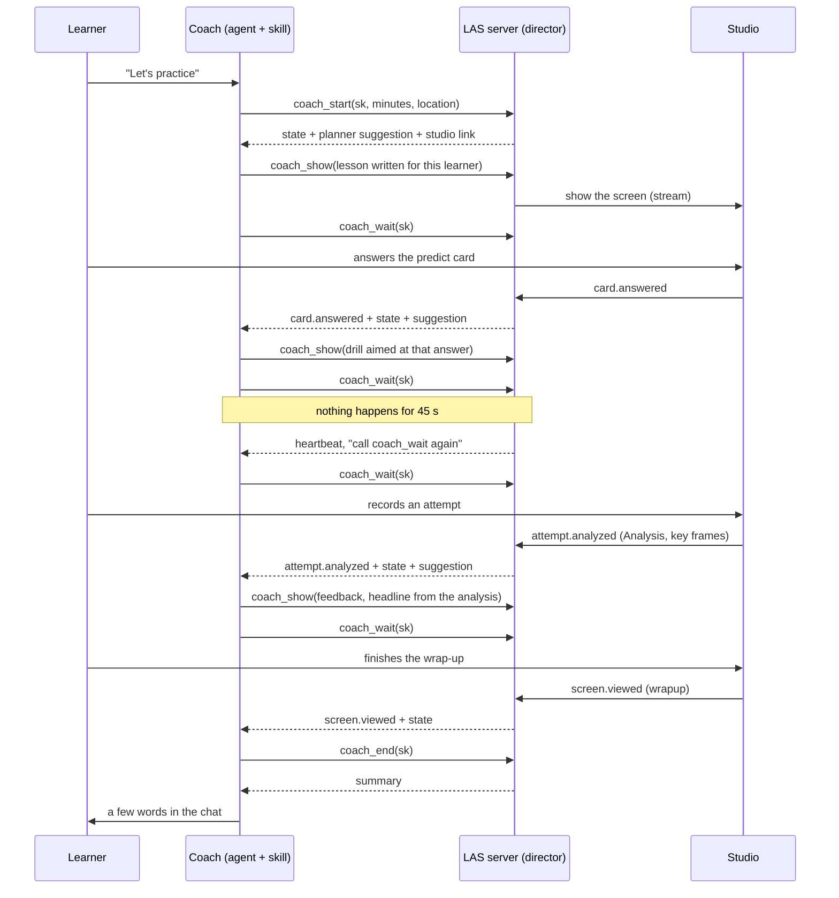
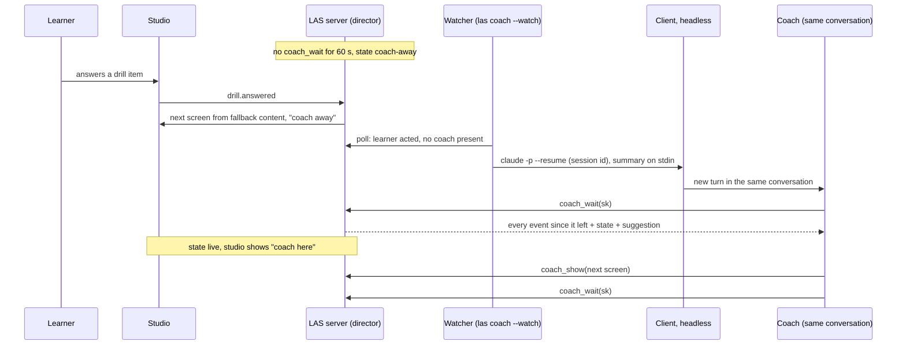
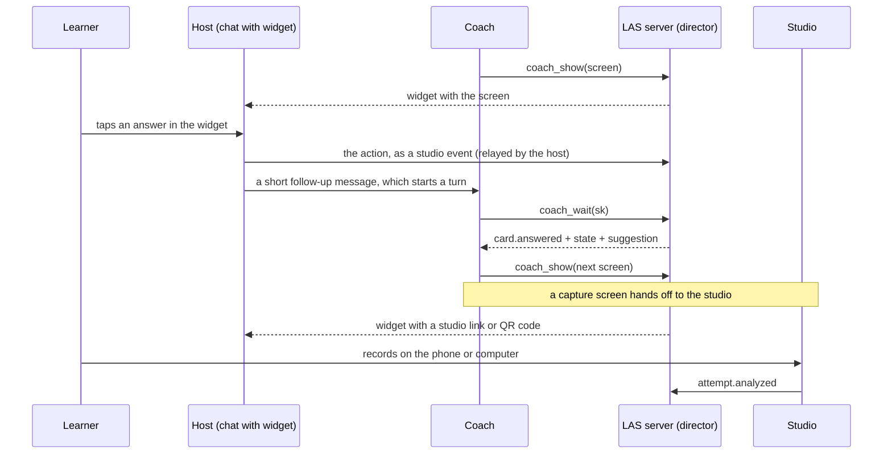
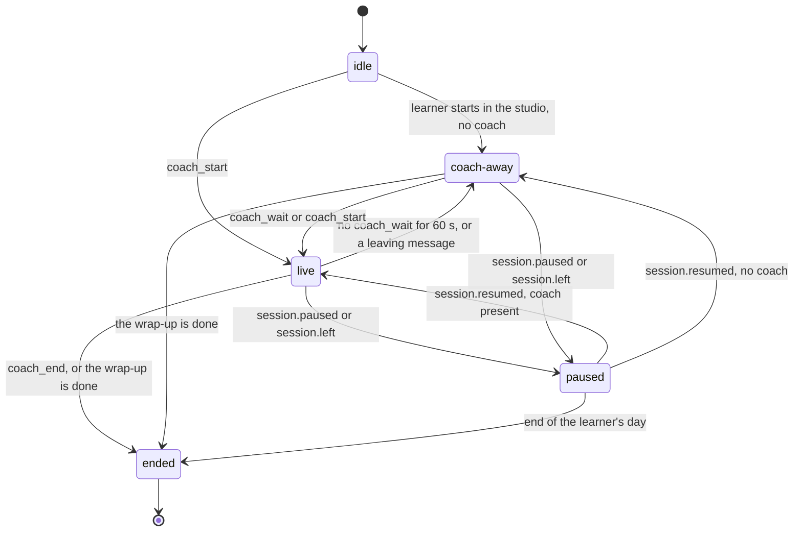

# The live coach

How the agent stays present during practice and writes each next screen for this learner, at this moment. Covers the coach loop, the watcher that brings a coach back, MCP Apps widgets, the events and screens, the session director, the fallback, timeouts, cost, privacy, failure modes and tests.

Related: [learning loop](learning-loop.md) · [MCP and data](mcp-and-data.md) · [skill models](skill-packs.md) · [evaluation](evaluation.md) · [any skill](any-skill.md) · [overview](../DESIGN.md) · clickable: [`prototypes/app`](../../prototypes/app/index.html) (session 1 shows the screens a coach writes; in the prototype they are pre-written)

Status: approved design, not built yet (v0.2 in the [build plan](../DESIGN.md#13-build-plan)). First client: **Claude Code**.

---

## 1. The problem

**Today (v0.1)** the agent writes the whole session up front. The skill model holds every lesson card, drill item and feedback headline. The studio runs the session with no model in the loop. The agent comes back only when it calls a tool (`next_session`, `get_analysis`, `get_session_summary`).

**From v0.2** the agent is a **live coach**. It watches the learner move through the screens and writes each next screen for this learner, now: a lesson that uses the wrong answer they just gave, a drill aimed at the mistake in the clip they just recorded, a short answer to the question they just typed.

**The constraint.** An MCP server can't start a turn in the agent. Only the client can. So LAS needs a way to keep the agent's turn open, or to start a new one from outside. Three mechanisms, in priority order:

| # | Mechanism | How the agent hears about the learner | Clients | When |
|---|---|---|---|---|
| 1 | **Coach loop** in one conversation | `coach_wait` blocks until something happens in the studio | Any client that allows a tool call of about a minute; Claude Code first | Default |
| 2 | **Watcher** re-wakes the coach | `las coach --watch` resumes the same conversation headlessly | Claude Code first; Codex, OpenCode, Goose later; Claude Desktop gets a notification | When the loop broke or the coach left |
| 3 | **MCP Apps widget** in the chat | The widget relays the learner's action through the host | Hosts that render MCP Apps | Second route, after Claude Code |

**When no coach is reachable**, the session still runs. The studio shows "coach away" and serves the content the agent wrote at model time (§9). Sessions never block on a model.

## 2. Who does what

| Part | Job | Never does |
|---|---|---|
| **Coach** (the agent, guided by the skill) | Reads events and state; writes the next screen; answers questions in a few words; proposes plan changes | Grades raw media; changes the plan silently; writes outside the budgets |
| **Session director** (new, in the server: `packages/server/src/core/director.ts`) | Holds the live session's state; queues events for the coach; validates and shows screens; applies the presence rule; serves fallback screens | Decides what to teach (that's the coach, advised by the planner) |
| **Planner** (`core/planner.ts`) | Scores candidates as before and **suggests** the next item with its reason | Has the last word while a coach is present |
| **Engines** | Measure, as before. The only source of numbers | Write words for the learner |
| **Studio** (PWA, `packages/studio`) | Shows screens, sends learner actions as events, shows "coach here" or "coach away", hosts the ask-the-coach box | Talks to the agent directly |
| **Watcher** (new, in the CLI: `las coach --watch`) | Notices learner actions with no coach present and resumes the coach's conversation | Coaches; it only wakes |

Every rule in the learning loop still holds: one new idea per session, 70–85% success, one fix at a time, nothing changes silently, pain means stop ([learning loop](learning-loop.md)). Principle 5 is unchanged: engines measure, the coach writes the words around the numbers.

## 3. Mechanism 1: the coach loop

The agent's turn stays open for the whole session. It loops: wait, decide, show, wait.



### 3.1 The four tools

| Tool | Input | Output |
|---|---|---|
| `coach_start` | `sk, minutes?, location?, client?, clientSessionId?` | Opens a live session: plans it (`SessionPlan`, now advice), creates the `live_session` row, returns the first state, the planner's suggestion, the studio link (or widget) and the loop instruction. If this coach already holds a live session for `sk`, it re-attaches and returns the current state |
| `coach_wait` | `sk, timeoutS?` (default 45, capped at 55) | Blocks until an event arrives, then returns `{events[], state, suggestion, instruction}`. After `timeoutS` with no event it returns `heartbeat` with the instruction to call again. Returns at once if undelivered events are waiting |
| `coach_show` | `sk, screen` | Validates one screen (§7) and shows it, or queues it as the next screen. Returns `{ok, errors[], screenId, shown \| queued}`. Over budget or unsafe: rejected with errors, nothing shown |
| `coach_end` | `sk` | Closes the session (shows the fallback wrap-up first if the coach didn't show one) and returns the `SummaryView` |

`clientSessionId` is the client's own conversation id, when the agent knows it. The watcher needs it to resume this conversation (§4).

### 3.2 What `coach_wait` returns

```ts
interface CoachWaitResult {
  liveSessionId: string;             // = the session's id
  events: CoachEvent[];              // in order; empty on a heartbeat
  heartbeat?: true;
  state: {
    state: "live" | "coach-away" | "paused" | "ended";
    block: BlockKind; step: number;  // screen index inside the block
    minutesUsed: number; minutesPlanned: number;
    screen: { id: string; kind: ScreenKind; source: "coach" | "fallback"; shownAt: string };
    queued?: { id: string; kind: ScreenKind };
    mastery: { nodeId: string; name: string; before: number; now: number }[];   // deltas so far
    mistakes: { id: string; state: string }[];
    difficulty: Record<string, number>;
    intensityCap?: number; injuries: string[]; location?: string;
    studio: { connected: boolean; lastSeenAt: string };
  };
  suggestion: { item: SessionItem; block: BlockKind; reason: string; fallbackScreenId?: string };
  instruction: string;               // e.g. "Call coach_wait again." or "Show the next screen, then call coach_wait."
}
```

The state is kept small (a target of 2 KB of JSON per return) so long sessions don't flood the context. Full views stay one tool call away (`get_progress`, `get_analysis`).

**Delivery.** Events are delivered in order, at least once. A batch counts as delivered when the coach makes its next `coach_wait` call. If a reply is lost (the client timed out), the next call gets the same events again; each event has an id so the coach can skip repeats. After the first event the server waits up to 300 ms for more, so a `drill.answered` and the `screen.viewed` that follows it arrive together.

## 4. Mechanism 2: the watcher

`las coach --watch` watches the event queue. When the learner acts and no coach has called `coach_wait` in the last 60 s, it resumes the coach's conversation headlessly. The resumed coach calls `coach_wait`, gets everything that happened while it was away, and picks up the loop.



**How it runs.** `las coach --watch` polls the store every few seconds and keeps running. `las coach --watch --once` does one pass and exits, for cron, like `las checkin`. Without `--once` it also serves the studio when no other LAS process holds the port, so the studio stays up after the coach's client exits (§14).

**The summary it sends** names the skill, the session and the event types, and says "call coach_wait". It never carries the learner's typed text or any analysis. The coach reads those through `coach_wait`. The summary goes on stdin, not the command line, so it doesn't show in the process list.

**When it wakes a coach**

- only for learner actions (`screen.viewed`, `card.answered`, `drill.answered`, `attempt.analyzed`, `learner.asked`, `pain.reported`, `session.resumed`); never for `learner.hesitated`, `session.paused` or `session.left`;
- at most one wake in flight per live session, at most one every 2 minutes, at most 5 per session (starting values, settings);
- never when the coach left on purpose with a `message` that said so (§15) until the learner asks for the coach (`learner.asked`);
- never into a conversation that is still open in an interactive client. The director records the process id of the LAS server that holds the coach (`live_session.coach_pid`). If that process is still alive, the client is still open, and a headless resume would fork the conversation. The watcher sends a notification instead ("Your coach is waiting in Claude Code").

### 4.1 Adapters: one row per client

Like the code runners' language table (`packages/runners/src/languages.ts`) and the setup CLI's client table (`packages/cli/src/clients.ts`), each client is one entry in a data table (`COACH_ADAPTERS` in the CLI). Client ids match `clients.ts`.

| Client | Headless command | How the session id is captured | When it can't be resumed |
|---|---|---|---|
| `claude-code` (first) | `claude -p --resume <id> --allowedTools "mcp__las__*" --output-format json`, summary on stdin | 1. A SessionStart hook that `las-agents setup` installs writes the hook's `session_id` to `~/.las/clients/claude-code/<pid>.json`, keyed by the Claude Code process id; on `coach_start` the LAS server walks its parent processes to find it. 2. Else the `clientSessionId` the agent passed. 3. After each headless run the watcher stores the `session_id` from the JSON output, in case resuming changed it. ⚠ verify all three | Notification with the prompt to paste (`/las-session`) |
| `codex` (later) | `codex exec resume <id>` with the summary ⚠ verify | ⚠ open: the agent's `clientSessionId`, or the newest session file for this working folder | Notification |
| `opencode` (later) | `opencode run --session <id>` with the summary ⚠ verify | ⚠ open | Notification |
| `goose` (later) | `goose run --resume --name <name>` with the summary ⚠ verify | ⚠ open: the session name | Notification |
| `claude-desktop` | none: no headless mode | not needed | Desktop notification (studio Web Push, or the OS notifier) that opens Claude Desktop with `/las-session` prefilled where the app allows it ⚠ open |
| `cursor`, `continue`, `cline` | none known ⚠ check | not needed | Notification |

**Permissions.** A resumed coach may call LAS tools only (`mcp__las__*` in Claude Code). It can't run shell commands or touch files without the learner.

**When nothing can be resumed** the session keeps going on fallback content, the studio keeps showing "coach away", and the notification tells the learner how to bring the coach back. Nothing is lost: the events wait in the queue.

## 5. Mechanism 3: MCP Apps widgets

Where the host renders [MCP Apps](https://github.com/modelcontextprotocol/ext-apps), `coach_start` and `coach_show` return the screen as the LAS widget, drawn in the learner's theme, inside the chat. The learner works in the widget and the widget relays each action through the host.



- Cards, knowledge drills, feedback, messages, plan options and the wrap-up work inside the widget.
- **Camera and microphone work hands off to the studio** (a link, or the QR code for the paired phone). The analysis comes back as `attempt.analyzed` as usual.
- ⚠ Open: which hosts let a widget start an agent turn, and whether the widget's action reaches the server as a tool call or through the studio's `POST /api/events`.

## 6. Event catalogue

Events the coach receives from `coach_wait`. Each has `{id, type, at, screenId?}` plus the payload below. The studio sends them through `POST /api/events`; the server adds its own reaction (mastery, mistakes, caps) before queuing them.

| Event | Payload | Fires when |
|---|---|---|
| `screen.viewed` | `screenId, kind, source` (coach or fallback), `previous: {screenId, kind, seconds}` | The studio shows a screen. Carries the time spent on the previous one |
| `card.answered` | `screenId, card` (index), `cardType, answer, correct?, seconds` | The learner answers a `predict`, `compare` or `try-it` card |
| `drill.answered` | `screenId, drillId, itemId?, correct` or `success, score, difficulty, changed` (up, down or none), `mastery: {nodeId, before, after}[], done, outcome?` | Each knowledge item, and each performance drill's outcome. `done` and the full `DrillOutcome` come with the last one |
| `attempt.analyzed` | `attemptId, analysis` (the `Analysis`, with up to 3 annotated key frames by reference), `proof?` (the `ProofResult`), `top?` (the server's top-mistake pick, as advice) | The engine finishes an attempt. **Never media** |
| `learner.asked` | `screenId, text` (up to 280 characters) | The learner types in the studio's ask-the-coach box |
| `learner.hesitated` | `screenId, seconds` (20) | 20 s on a screen with no action. Once per screen. Not during a recording |
| `pain.reported` | `area, level, intensityCap` (the cap the server just applied) | The learner reports pain. The server lowers intensity first, as today |
| `session.paused` | `reason` (`learner`, `pain`) | The learner taps pause |
| `session.resumed` | `pausedSeconds` | The learner comes back |
| `session.left` | `reason` (`closed`, `studio-offline`) | The studio closes (sent by the studio), or the server hasn't heard from it for 5 minutes (made by the server) |
| `heartbeat` | `waitedS` | Nothing happened for `timeoutS`. Not stored. Means "call `coach_wait` again" |

**New studio events:** `screen.viewed`, `card.answered`, `learner.asked`, `learner.hesitated`, `session.paused`, `session.resumed`, `session.left` join `StudioEventSchema` (`packages/schema/src/events.ts`). `drill.answered` is made by the server from each item answer (`POST /api/drill/:id/next`) and from `drill.outcome`. `attempt.analyzed` and `pain.reported` already exist.

**Not wake events:** `review.graded`, `block.completed`, `attempt.captured`, `attempt.disputed` and `checkin.answered` still update the learner model as today. They show up in the next state, not as their own events.

## 7. Screen catalogue

What `coach_show` accepts. Each screen maps to a view model the studio and widget already draw (`packages/schema/src/views.ts`), so live screens and fallback screens look the same.

| `kind` | The coach writes | The server adds | View it renders as |
|---|---|---|---|
| `lesson` | `title, nodes, cards` (1–5 cards of the same `Card` types, 25 words each) | Validation, figure rendering | `SessionItem` `lesson` with `Card[]` (reused: the `lesson` view) |
| `drill` | A standard drill type. Knowledge drills (`choice, match, order, hotspot, predict-output, fill`) may carry their own items. Performance drills name a scaffold drill or spec and may set `difficulty` and a new `prompt` | Starting difficulty, items served one by one, grading by key or engine | `SessionItem` `drill` and `DrillStep` (reused: the `drill` view) |
| `capture` | Which scaffold drill or proof to attempt, and the `prompt` and `how` lines | The attempt, the capture spec, the studio or phone link | `SessionItem` `capture` (reused: the `capture` view) |
| `feedback` | `attemptId, headline` (8 words or fewer, from the analysis), `evidence` (a reference to a mistake or marker in that analysis), `fixDrillId`, optional `why` (a figure or one card), `praise` (8 words or fewer) | The analysis, precision, the before-and-after compare | `FeedbackView` (reused: the `feedback` view) |
| `message` | `text` (25 words or fewer), optional `figure`, `replyTo` (an event id), `leaving?` | — | **New** `CoachMessageView`, shown over the current screen |
| `plan` | `question` (25 words or fewer), 2–4 `options` (each a `replan` option or a `reschedule` value, with a label), `reason`, optional `checkinId` (also works outside a session: the coach's wording goes on Today and in the notification) | Applies the option the learner taps, logs it as a plan change | **New** `PlanProposalView`, using the option shape of `CheckinView` |
| `wrapup` | `praise`, `oneFix` headline, optional note on the next session (each within budget) | What changed, the metric, the next session | `SummaryView` (reused: the `summary` view) |

**Shortcut:** `coach_show(sk, "suggested")` shows the planner's suggestion with its pre-written content, for when it already fits.

**Warm-up and recall stay scaffold.** The warm-up comes from the model's safety fields and is never rewritten live. Recall shows the FSRS cards that are due. The director shows both itself; the coach may add a `message` around them.

**What `coach_show` checks** (the same checks `validate_skill_model` runs, applied to one screen):

- word budgets: cards 25, drill prompts 25, knowledge items 40, headlines 8, messages 25;
- only the standard card types, figure kinds and drill types; no new answer types;
- references exist: nodes, drills, specs, the attempt, and the mistake or marker cited as evidence;
- the evidence's confidence is at or above the floor (0.7); one fix per feedback screen; a failed quality check means a re-record, not feedback;
- a performance drill uses a validated spec: the coach can't invent a metric spec mid-session;
- safety: nothing above the intensity cap, nothing that conflicts with an injury, nothing that needs equipment the learner doesn't have here, nothing on the supervised-only list;
- a screen that differs from the suggestion carries a `reason` (§10).

**Showing.** A `message` shows at once, over the current screen. Every other kind becomes the **next** screen: it replaces any earlier queued coach screen, and shows when the learner finishes the current one, or at once if the learner is already waiting.

## 8. The session director

One live session per enrollment at a time. Its state is stored (`live_session`), not held in memory, because the process that serves the studio may not be the one the coach talks to (each stdio client starts its own LAS server; only one holds the studio port).



**The presence rule.** A coach is present while a `coach_wait` call is open, or one returned less than 60 s ago. A looping coach is always present: heartbeats come back within 55 s and it calls again at once. When the 60 s run out, the session goes to coach-away and the watcher may step in.

| State | What the studio shows | Where the next screen comes from |
|---|---|---|
| idle | Today, with Start | — |
| live | The coach's screens, "coach here", the ask-the-coach box | The coach's queued screen. If the learner finishes a screen and nothing is queued, a short "thinking" state, then the fallback after the **screen deadline** (8 s, a starting value and a setting) so a slow model never blocks practice |
| coach-away | "Coach away", fallback screens; the ask box still works and says the coach will answer when back | The planner's suggestion with the model's pre-written content |
| paused | A pause screen with Resume and the time so far | — |
| ended | The wrap-up and summary | — |

**How the studio hears.** Screens and state changes go to the studio over the existing stream (`GET /api/stream`) as `coach.screen` and `coach.state`. A studio that reconnects reads the current state and screen from `GET /api/live/:sessionId`. Learner actions go through `POST /api/events`, as today.

**One coach at a time.** The coach that called `coach_start` holds the session. A second `coach_start` for the same `sk` is refused while the holder is present, with a message naming the client that holds it. When the holder is away, the second coach takes over; that's logged, and the old holder's later `coach_show` calls are rejected with "another coach took over".

**Learners stop and resume the same day,** as today. A paused session ends at the end of the learner's day and keeps what was done.

**Stored data** ([MCP and data §6](mcp-and-data.md#6-data-model-sqlite)):

```
live_session(id, enrollment_id, state, coach_session_id, client, coach_pid, last_wait_at, started_at, ended_at)   -- id = session.id
coach_event(id, live_session_id, type, json, created_at, delivered_at)            -- the coach's event queue, in id order
coach_screen(id, live_session_id, kind, json, shown_at, answered_at)              -- every screen shown, live or fallback
```

`coach_session_id` is the client's conversation id that the watcher resumes; `client` is the client id from `clients.ts`; `coach_pid` is the LAS process that holds the coach; `last_wait_at` drives the presence rule. `coach_screen.json` records the screen's `source` (`coach` or `fallback`) and, for an override, its reason.

## 9. Fallback content and the skill model

The skill model becomes a **scaffold** plus **fallback content**. Both are still written by the agent at model time, and `validate_skill_model` still checks both. Details: [skill models §3.1](skill-packs.md#31-scaffold-and-fallback-content).

| | Fields | Required |
|---|---|---|
| **Scaffold** | why, pictures, probes, placement, ladder and proofs, the skill graph (nodes, prerequisites, BKT, review cards), drills with their types, specs, needs, success, difficulty and intensity, engine specs, mistakes with their detectors, names and fix drills, warm-ups and safety fields, access, injuries, focus, key metrics | Yes. Onboarding, the planner, engines and safety need them |
| **Fallback content** | lesson cards, practice-only knowledge items and drill prompts, mistake `headline`, mistake `explain` (the why) | Optional in the schema, checked whenever present. The skill tells the agent to write all of it, and the evals require it |

**The fallback rule.** Fallback content is used only when no coach is present (presence rule, §8), or after the screen deadline when a present coach hasn't written the next screen yet. While no coach is present the studio shows "coach away" and the watcher tries to bring the coach back. A screen served after the deadline is recorded with `source: fallback`, so the coach sees it in its next `coach_wait`.

**When fallback content is missing** the director never invents text. It skips to the next screen it can build from the scaffold (a performance drill, a capture, review cards), uses the mistake's `name` for a feedback headline, and leaves out the Why button. `validate_skill_model` warns about each gap.

## 10. The planner as adviser

The planner works as before: same inputs, same score (`0.35·(1 − mastery) + 0.25·mistake + 0.2·mix gap + 0.2·relevance`), same drop rules, same reasons ([learning loop §3](learning-loop.md#3-session-planner)). What changes:

- `coach_start` returns its `SessionPlan` as **advice**: the blocks and their time shares.
- Every `coach_wait` returns its **suggestion** for the next item, with the reason.
- The coach may **override** it. A screen that differs from the suggestion needs a `reason`, and the planner log records `{suggested, chosen, reason, by: "coach"}`, so the weights can still be tuned.
- **Plan changes** (route, milestone, dates, days, minutes per week) are never made by the coach directly. The coach proposes them as a `plan` screen; the learner taps; the server applies the choice and logs it as a plan change. Choosing the next drill or its difficulty is coaching, not a plan change, but it's logged too.
- The learner model (BKT, FSRS), mistake progression, check-ins and re-planning rules are unchanged.

**Live check-ins.** When the watcher can wake the coach, a due check-in goes to the coach first. The coach may word it for this learner as a `plan` screen with the check-in's `checkinId`. It shows on Today and in the push notification, within the same budgets and nudge limits. Without a coach, the server's own check-in text goes out as today.

## 11. Latency and cost

| Step | Expected |
|---|---|
| Studio event to `coach_wait` return, same process | under 100 ms |
| The same, across processes (polling the store every 250 ms) | under 500 ms |
| The coach writes a short screen (message, drill, feedback) | a few seconds, model dependent |
| The coach writes a 5-card lesson | longer; written ahead, during the screen before |
| Watcher wake to the coach's first `coach_wait` | the client's start-up time plus one turn ⚠ measure |

**Writing ahead** hides most of the model's time. Most screens take the learner 30 s to 5 minutes. The coach queues the next screen while the learner works on the current one.

**Cost.** A 30-minute session takes about **15–25 round trips** that need a decision, plus about one heartbeat for every 45 s of quiet (each a small turn with almost no output). The state is kept small and the conversation's prefix is stable, so client-side prompt caching keeps each turn cheap. ⚠ Open: real token counts per session, per client and model.

## 12. Timeouts

- **Heartbeat:** `coach_wait` returns after `timeoutS` (default 45 s, capped at 55 s). Many MCP clients stop waiting for a tool result after 60 s (the TypeScript SDK's default request timeout), so 55 s keeps every client safe.
- **Progress:** while waiting, `coach_wait` sends MCP progress notifications every 10 s when the client gave a progress token. Some clients reset their timeout on progress; LAS doesn't rely on it.
- **Claude Code:** its tool timeout is the `MCP_TOOL_TIMEOUT` environment variable (milliseconds; default 100000000, about 28 hours, per the Claude Code docs). The variable applies to every MCP server, so `las-agents setup` writes 1800000 (30 minutes) into the `env` block of `~/.claude/settings.json` only when it is unset or below 120000, and never lowers a larger value. Calls longer than `CLAUDE_CODE_MCP_AUTO_BACKGROUND_MS` (default 120000) move to the background; a 55 s wait never reaches that.
- **Other clients:** setup sets each client's tool timeout where its config has one (Goose already gets `timeout: 300`; Codex's per-server tool timeout ⚠ verify; OpenCode ⚠ verify). The setting sits in the client's row of `clients.ts`.
- **Screen deadline:** 8 s (§8). **Presence window:** 60 s. **Watcher:** one wake every 2 minutes, 5 per session. All are settings.

## 13. Privacy

- Events carry analyses and up to 3 annotated key frames by reference. **Never media.** The rule from [evaluation §1](evaluation.md#1-evaluator-contract) is unchanged.
- `learner.asked` carries the learner's own words to the agent. The ask box says so.
- The watcher's summary carries no learner text and no analysis, and goes on stdin.
- A resumed coach can call only LAS tools.
- `coach_event` and `coach_screen` rows are learner data: export and delete cover them.

## 14. Failure modes

| What happens | What LAS does |
|---|---|
| The coach disconnects mid-session (client closed, context full, the learner pressed Esc) | After 60 s the session goes coach-away; fallback screens keep it running. If the LAS process that held the coach has exited, the watcher resumes the conversation; if it's still alive, the watcher sends a notification instead |
| The coach's tool call times out | The coach calls `coach_wait` again and gets the same events (at-least-once delivery, §3.2) |
| The coach writes an invalid screen | `coach_show` rejects it with errors; the current screen stays; the coach fixes it and calls again. After the screen deadline the fallback shows |
| Two coaches | One holder (§8). The second is refused while the first is present, and takes over only when it's away |
| The studio goes offline | The studio queues events and sends them in order when it reconnects, as it does for attempts recorded with no signal. After 5 minutes the coach gets `session.left` (`studio-offline`) and keeps waiting, or ends the session with a message |
| The studio's server exits with the coach's client | Every LAS process that failed to take the studio port retries every few seconds, and `las coach --watch` serves the studio when the port is free, so another process takes over |
| The coach goes quiet without leaving | Heartbeats keep it in the loop. If it stops calling, the presence rule hands over to the fallback |
| The model can't see images | Unchanged: rubric grading follows [evaluation §3.1](evaluation.md#31-visual-grading-flow) |

## 15. Agent rules for the loop

The skill ([skill/SKILL.md](../../skill/SKILL.md)) tells the agent:

1. **Stay in the loop.** After `coach_start`, loop `coach_wait` → decide → `coach_show` → `coach_wait` until `coach_end`. Keep the turn open for the whole session.
2. **A heartbeat means call again.** Don't reply to the learner in the chat, don't end the turn.
3. **Write within budget.** Live screens use the same card types, drill types and word budgets as the model. No essays; `message` is 25 words or fewer.
4. **Measure, then coach.** Write feedback from the analysis only, and cite its evidence. Never grade raw recordings.
5. **Never leave silently.** If you must stop, send a `message` with `leaving: true` that says so; the session continues on fallback content.
6. **Override the planner only with a reason.** It goes in the planner log.
7. **Nothing changes silently.** Plan changes are `plan` screens the learner taps.
8. **Pain means stop.** On `pain.reported` the server has already lowered intensity. Show a message, then an easier screen or `coach_end`, and suggest a professional if it continues.
9. **Silence is fine.** On `learner.hesitated`, at most one short nudge per screen, never during a recording.
10. **Pass your session id** to `coach_start` (`clientSessionId`) when you know it.
11. **Answer questions short.** `learner.asked` gets a `message`, with a visual if needed, then back to practice.
12. **When woken by the watcher,** call `coach_wait` first; it hands over everything that happened while the coach was away.

`next_session`, `get_analysis` and `get_session_summary` stay, for clients that can't hold a long tool call.

## 16. Testing

| Test | What it drives | What it checks |
|---|---|---|
| **Scripted learner** | Posts studio events from a script with timings (a fake clock), through `POST /api/events` | The director's states and what the studio is told to show |
| **Scripted coach** | An in-memory MCP client (like `evals/src/harness.ts`) that loops `coach_wait` → `coach_show`, following the suggestion, overriding it with a reason, or stopping on purpose | The loop end to end, with no model |
| **Budget evals** | A scripted coach that tries an essay, an unknown card type, a made-up metric spec, a drill over the intensity cap | Every one is rejected with errors; nothing over budget reaches the studio |
| **Fallback evals** | The scripted coach stops calling | After 60 s the state is coach-away, the next screen is the fallback, a fake watcher adapter is called once, and the coach gets every missed event when it comes back |
| **Ordering evals** | Bursts of events, lost replies, two processes sharing one store | Events arrive in order, at least once, with ids; nothing is skipped |
| **Latency evals** | The scripted learner and coach with a real clock | Event-to-return under the targets in §11; the screen deadline holds |
| **Two-coach and offline evals** | A second `coach_start`; a studio that drops and reconnects | §14 behavior |
| **Real agent, manual** | Claude Code with the skill, a full 30-minute session | Round trips, tokens, how the screens read. Not in CI, like the v0.1 real-agent runs |

## 17. Open questions

- **Session id discovery per client.** How does the agent, or LAS, learn the client's conversation id in each client? The Claude Code hook-and-parent-process approach needs checking; Codex, OpenCode and Goose are open.
- Does a headless resume (`claude -p --resume`) keep the same session id, and is it safe while the interactive window still shows that conversation?
- **Cost per session:** real token counts per client and model, and whether heartbeats should back off during long recordings.
- **What should the coach do when the learner is silent** beyond one nudge per screen: wait, offer a shorter session, or pause?
- Which hosts let an MCP Apps widget start an agent turn, and how the widget's actions reach the server.
- Is 8 s the right screen deadline, and should a late coach screen ever replace a fallback screen the learner has already started?
- Should `attempt.disputed` wake the coach?
- Claude Desktop: can a notification open the app with `/las-session` prefilled?
