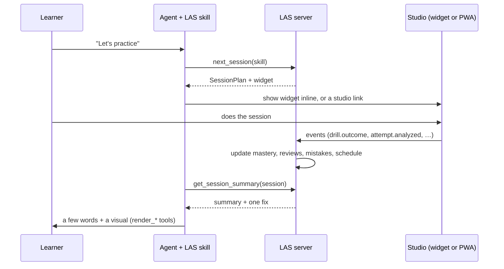

# MCP tools, agent behavior and data

How the agent, the LAS server and the studio talk to each other: the tool contracts, the rules the agent follows, events, and the stored data.

Related: [any skill](any-skill.md) · [learning loop](learning-loop.md) · [evaluation](evaluation.md) · [skill models](skill-packs.md) · [overview](../DESIGN.md)

---

## 1. How the pieces talk



- **Inline when possible:** if the client renders MCP Apps, sessions, drills and progress appear inside the chat. Otherwise tools return a studio link to the same screen (`http://127.0.0.1:4711/app/...`, e.g. `/app/today`, `/app/capture/<attemptId>`, `/app/feedback/<attemptId>`).
- **The server is the source of truth.** The agent never keeps learner state in its own memory; it reads it back through tools and resources.

**Studio JSON routes.** The studio and the widgets call the same core functions as the tools, over a small JSON API on `127.0.0.1:4711` (`packages/server/src/http`). Events go through one route, `POST /api/events`.

| Area | Routes |
|---|---|
| Server | `GET /api/health`, `GET /api/capabilities` (`?fresh=1` re-detects), `POST /api/devices` (the studio reports camera, microphone, motion and phone), `GET /api/stream` (live events), `POST /api/events` |
| Theme | `GET /api/theme` (`?sk=`), `GET /api/fonts/:family/font.css` and `/:file` (the local font cache) |
| Onboarding | `GET /api/state`, `GET /api/intake/:id`, `POST /api/intake/:id/answer`, `/place`, `/suggest`, `/feasibility`, `/milestone` |
| Sessions | `GET /api/today`, `POST /api/session/next`, `GET /api/session/:id`, `POST /api/drill/:id/next`, `GET /api/reviews` |
| Attempts | `GET /api/attempt/:id`, `POST /api/attempt/:id/evidence` (the studio's measurements; analyzed on the server), `POST /api/attempt/:id/analysis` (an analysis the studio already computed), `GET /api/attempt/:id/feedback`, `POST` and `GET /api/media/:attemptId` (the learner's own file, kept on the device) |
| Code | `POST /api/code/run`, `POST /api/consent` (a runner's first-use consent) |
| Progress | `GET /api/progress`, `GET /api/summary/:sessionId`, `GET /api/checkins`, `POST /api/checkins/run` |
| Models | `GET /api/models/*` (cached model files served to the studio) |

The studio package adds its own routes for phone pairing and push subscriptions (see packages/studio). `submit_rubric_grade` is a tool only: the agent's grades arrive through it, not through a route.

## 2. Tools

Inputs and outputs, simplified. `sk` = a learner's enrollment in one skill (a learner can learn several skills).

### Skill
| Tool | Input | Output |
|---|---|---|
| `get_capabilities` | — | Engines and their status, code runners and detected toolchains, devices, external tools on `PATH` ([Any skill §5](any-skill.md#5-finding-and-choosing-tools)) |
| `draft_skill_model` | `skill, notes?` | An empty skill model with the schema, the engines that are available, and a curated pack to start from if one exists |
| `validate_skill_model` | `SkillModel` | `{ok, errors[]}`: every check in [skill models §4](skill-packs.md#4-checks-every-skill-model-must-pass). Stores the model once it passes |
| `get_skill_model` | `skill \| sk` | The stored model, for viewing or revising |

### Theme
The tools in [Theming §7](theming.md#7-tools-and-data): `draft_theme`, `validate_theme`, `preview_theme`, `set_theme`, `get_theme`.

### Onboarding
| Tool | Input | Output |
|---|---|---|
| `start_intake` | `skillModelId` | `{intakeId, whyOptions, widget}` |
| `record_answer` | `intakeId, field, value` | `{next, options}`: options already ranked for this learner |
| `place_learner` | `intakeId` | `{step, evidence}` |
| `suggest_milestones` | `intakeId` | `Suggestion[]` (quick win, toward your picture, stretch) |
| `check_feasibility` | `intakeId, milestone` | `{verdict, weeks, steppingStone?}` |
| `set_milestone` | `intakeId, milestone` | `{sk, route, firstSession}` |

### Plan
| Tool | Input | Output |
|---|---|---|
| `get_today` | `sk` | `TodayView` (next session, reviews due, milestone, check-in) |
| `next_session` | `sk, minutes?, location?` | `SessionPlan` (blocks, each with a reason) + widget |
| `reschedule` | `sessionId, when \| "skip"` | Updated schedule |
| `replan` | `sk, option` | New route and dates (options come from a check-in) |

### Teach
| Tool | Input | Output |
|---|---|---|
| `render_lesson` | `LessonSpec` (cards, 25-word budget) | Widget. **Rejects specs over budget** |
| `render_sim` | `SimSpec`: parameters with ranges, formulas, a plot or figure, a live readout | Interactive widget for any concept. Declarative, so nothing the agent writes runs as code |
| `render_mechanism` | `concept` | anatomy figure (cached) |
| `render_diagram` | `DiagramSpec` (mermaid, d3, notation, code trace) | Widget |
| `explain_mistake` | `mistakeId, attemptId?` | The mistake's explanation visual, using the learner's own frame when there is one |

### Practice
| Tool | Input | Output |
|---|---|---|
| `start_drill` | `drillId, difficulty?` | Widget |
| `review_cards` | `sk, n?` | Widget with due FSRS cards |

### Evaluate
| Tool | Input | Output |
|---|---|---|
| `request_capture` | `attemptSpec` | Recording widget or studio link (opens on the phone if paired) |
| `get_analysis` | `attemptId` | `Analysis` ([evaluation §1](evaluation.md#1-evaluator-contract)) + the feedback card (and the `ProofResult` for a proof attempt). For a visual attempt still waiting for rubric grades with an uploaded picture: the picture as an MCP image block (up to 1.5 MB; larger ones are linked), the rubric prompt and the instruction to call `submit_rubric_grade` |
| `run_code_tests` | `TestSpec, files` | Test results from the best available runner (asks the learner before a runner's first use) |
| `compare_to_reference` | `attemptId, reference` (`reference`: the attempt id of an analyzed reference attempt) | For movement, the engine lines up the body points with the reference's over time; otherwise similarity metric by metric against the reference attempt's analysis |
| `run_proof_check` | `milestoneId \| sk, proceed?` | Readiness first (what's missing, if anything; `proceed: true` takes it anyway), then the recording flow; the `ProofResult` comes with `get_analysis` |
| `submit_rubric_grade` | `attemptId, grades[]` (`criterion, level, confidence, region?, note?`) | The agent's own grades for a visual (rubric) attempt. The visual engine adds its measurements, stores the `Analysis` and returns the feedback card ([evaluation §3.1](evaluation.md#31-visual-grading-flow)) |

### Track
| Tool | Input | Output |
|---|---|---|
| `get_progress` | `sk` | Progress widget + data |
| `get_session_summary` | `sessionId` | What changed, one fix, next session |
| `log_external` | `sk, minutes, note` | Logs practice done outside the app |
| `report_pain` | `sk, area, level` | Lowers intensity now, schedules a follow-up |
| `revisit_why` | `sk` | Why and six-month questions again |
| `export_data` | `scope` (`sk` or `all`) | A file |
| `delete_data` | `scope` (`sk` or `all`), `confirm: true` | Deletes the skill's (or all) data and media files. Without `confirm: true` it refuses and says it can't be undone; the agent asks the learner first |

## 3. Resources and prompts

- **Resources (read-only):**
  - `las://learner/profile`
  - `las://skills/{sk}/route`
  - `las://skills/{sk}/progress`
  - `las://skills/{sk}/mistakes`
  - `las://skills/{sk}/model`
  - `las://packs/{pack}` (curated packs)
- **Prompts:**
  - `/las-start`: learn something new
  - `/las-session`: today's session
  - `/las-weekly-review`
  - `/las-stuck`: plateau or motivation conversation

## 4. Agent rules (in the skill)

1. **Visuals first.** Before explaining anything, call a `render_*` tool. No more than 2 sentences of prose between visuals. No headings or bullet lists explaining a concept.
2. **Never grade raw recordings.** Grade only from `get_analysis`, and quote its evidence.
3. **One fix at a time,** plus one thing done well.
4. **No silent plan changes.** Offer `replan` options and let the learner choose.
5. **Pain means stop:** call `report_pain`, lower intensity, and suggest a professional if it continues. Never diagnose.
6. **Talk to the learner's why,** not to guilt. No countdowns or "you broke your streak".
7. **Unsure means ask** for a better recording, never guess.
8. **Work out the skill, don't wait for instructions.** For a new skill, call `get_capabilities`, decide which engines the skill needs, write the skill model, and call `validate_skill_model` until it passes. Start from a curated pack if `draft_skill_model` offers one.
9. **Use what's there.** Prefer other MCP servers, skills and tools the client already has when they fit (routing table in [Any skill §5](any-skill.md#5-finding-and-choosing-tools)). Third-party servers need the learner's consent and are never required.
10. **Say when a check is weaker.** If the best engine isn't available, use the fallback, tell the learner the check is less precise, and suggest an open-source install.

## 5. Events

The studio sends events to the server. The server updates models and schedules; the agent reads the results.

| Event | Payload | Server reaction |
|---|---|---|
| `session.started` / `session.completed` | session id, minutes | Time log, adjust the next session |
| `block.completed` | block, duration | Mix tracking |
| `drill.outcome` | nodes, success, score, metrics, mistakes | Update BKT mastery, in-session difficulty, mistake states |
| `review.graded` | card, grade | FSRS schedule |
| `attempt.captured` / `attempt.analyzed` | attempt id, `Analysis` | Mistakes, proof criteria, before-and-after |
| `pain.reported` | area, level | Lower intensity, injury rules, follow-up |
| `checkin.answered` | check-in, option | Re-plan, reschedule, pause |

## 6. Data model (SQLite)

The tables the migration creates (packages/store/src/migrations.ts). JSON columns hold TEXT.

```
learner(id, name, timezone, quiet_hours, nudge_limits, created_at)
skill_model(id, skill, source[generated|curated], based_on_pack, pack_version, version, json, validated_at, created_at)
enrollment(id, learner_id, skill_model_id, status[active|paused|done], created_at)
theme(id, learner_id, name, source_kind, json, validated_at, created_at)
theme_scope(learner_id, enrollment_id, theme_id)                              -- enrollment_id '' = all skills
intake(id, learner_id, skill_model_id, answers, step, placement, enrollment_id, created_at, completed_at)
intent(enrollment_id, why, afterwards, revisited_at)
constraints(enrollment_id, minutes_per_week, deadline, access, injuries, schedule, location)
milestone(id, enrollment_id, title, ladder_step, proof, target_date, status, achieved_at, self_reported, kind, estimate_weeks, feasibility, created_at)
node_mastery(enrollment_id, node_id, p_known, attempts, started, updated_at)    -- BKT
review_card(id, enrollment_id, node_id, fsrs_state, due_at)                      -- FSRS
session(id, enrollment_id, planned_at, started_at, ended_at, plan, location, minutes, summary, status)
attempt(id, session_id, enrollment_id, drill_id, milestone_id, kind, engine, spec_id, attempt_no, media_ref, analysis, spec, prompt, created_at, analyzed_at)
mistake_state(enrollment_id, mistake_id, state, last_seen_at, disputed_count, clean_streak, seen_count)
checkin(id, enrollment_id, kind, due_at, sent_at, answered_at, answer, payload)
plan_change(id, enrollment_id, reason, option, created_at)                        -- every re-plan, logged
event(id, enrollment_id, type, json, created_at)                                  -- studio and loop events
planner_log(id, session_id, json, created_at)                                     -- why each block was chosen
time_log(id, enrollment_id, minutes, category, source, note, created_at)
setting(key, value)                                                               -- consents, baselines, preferences
pairing(token, created_at, used_at, device, expires_at)                           -- phone pairing
push_subscription(id, learner_id, json, created_at)
dispute(id, enrollment_id, attempt_id, mistake_id, metrics, consent, created_at)
proof(id, enrollment_id, milestone_id, attempt_id, result, clip_ref, created_at)
metric_history(id, enrollment_id, metric_id, value, attempt_id, created_at)
```

`media_ref` points to a file on the device. Derived evidence (body points, pitch tracks, transcripts, test results) is kept next to it as `evidence.json`.

Media files stay on the device under `~/.las/media/<attempt>`. The database only stores references and derived data.

## 7. Sync and multiple devices

- **Local mode:** one SQLite file is the source of truth.
- **Hosted mode:** self-hosted sync (ElectricSQL or libSQL) of the tables above. **Media is never synced** unless the learner turns it on for a specific proof clip.
- **Phone paired with a computer:** the phone sends events and analyses to the computer's server over the pairing link. The phone keeps its own copy of the raw media.

## 8. Security

- The local server listens only on `127.0.0.1`. Phone pairing adds a single-use QR token and HTTPS from mkcert.
- Hosted mode uses OAuth for MCP clients and per-learner row-level access.
- Export and delete are real tools that cover everything, media included.
