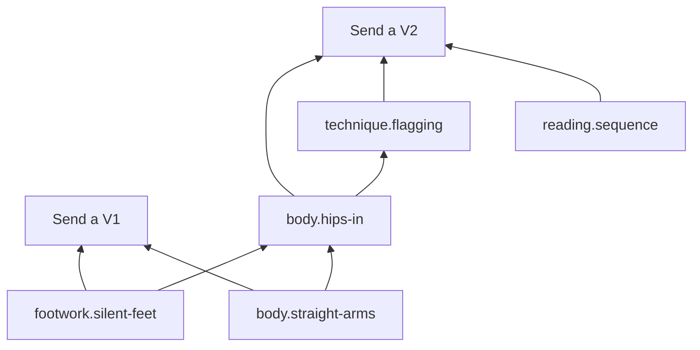

# Skill packs

A skill pack is all the content for one skill: its ladder, skill graph, lessons, drills, mistakes and proof standards. Packs are data, not code. They plug into the same onboarding screens, session blocks and evaluators.

Related: [learning loop](learning-loop.md) · [evaluation](evaluation.md) · [MCP and data](mcp-and-data.md) · [overview](../DESIGN.md)

---

## 1. Layout

```
packs/bouldering/
├── pack.yaml          name, evaluator, why[], pictures[], probes[], ladder[], access, injuries, focus, key metrics
├── nodes/             skills and concepts with prerequisites (the skill graph)
├── lessons/           teaching-card specs (25 words per card or fewer)
├── drills/            drills of the standard types, with how difficulty rises
├── mistakes/          detectors + explanation + fix drill
├── proofs/            proof standard for each ladder step
├── warmups/           physical skills only
├── media/             reference clips, poses, audio (each file carries its license)
├── tests/             labeled example attempts for evaluator regression tests
└── LICENSE            CC-BY-4.0 or CC0 for pack content
```

Packs are written in YAML and compiled to JSON. The YAML parser is `yaml` (ISC).

## 2. Ladder and skill graph

The **ladder** is what learners see: steps with estimated hours and a proof standard. The **skill graph** is what the planner uses: each ladder step needs a set of skills, and skills depend on other skills.



```yaml
# nodes/body.hips-in.yaml
id: body.hips-in
name: Hips close to the wall
requires: [footwork.silent-feet, body.straight-arms]
lesson: lessons/hips-in.yaml
drills: [drills/hip-in-traverse.yaml, drills/hips-in-v0.yaml]
mistakes: [mistakes/hips-away.yaml]
mastery:
  evidence: [drill.outcome, attempt.analyzed]
  bkt: { p_init: 0.1, p_learn: 0.2, p_slip: 0.1, p_guess: 0.15 }
review: { card: "Where do your hips go on a vertical wall?", kind: hotspot }
```

## 3. Lessons and drills

```yaml
# lessons/hips-in.yaml
cards:
  - type: predict
    text: Which hip position puts less weight on your arms?
    options: [Close to the wall, Away from the wall]
    answer: 0
  - type: sim
    text: Drag your hips. Watch the arm load.
    sim: lean-model
    params: { hip_cm: [5, 60] }
    readout: arm_load_pct
  - type: compare
    text: Same hold, two climbers. Tap the difference.
    left: media/hips-in.mp4
    right: media/hips-out.mp4
    hotspot: hips
```

```yaml
# drills/hip-in-traverse.yaml
type: move
nodes: [body.hips-in]
evaluator: movement
capture: { angle: side-45, duration_s: 60 }
needs: [climbing-gym]
success: "share(hip_wall_ok) >= 0.7"
difficulty: { param: wall_angle, levels: [vertical, slight-overhang, overhang] }
```

## 4. Checks every pack must pass

`las pack validate` checks:
- the schema is valid, and every lesson card stays within the word budget;
- every ladder step has a proof standard and at least one skill;
- the skill graph has no cycles, and every skill can be reached from step 0;
- every skill has at least one lesson, one drill and one review card;
- every mistake has a detector, a fix drill and an explanation visual;
- drills use only the standard types and only evaluators that exist;
- every media file declares a license from the allowed list (CC0, CC-BY, or the pack's own license).

`las pack test` runs every evaluator over `tests/` and checks the expected mistakes and criteria come out ([evaluation §8](evaluation.md#8-testing-evaluators)).

`las pack preview` opens the studio with the pack loaded, including onboarding.

## 5. Skills without a pack

For a skill with no pack, the agent drafts one with `draft_pack(skill)`:

1. It fills `pack.yaml` (why options, six-month pictures, the level question, a ladder of 5–7 steps with rough hours) and a small skill graph.
2. Drills and proofs use only what works for any skill: the **knowledge** evaluator, the **craft** evaluator (rubric plus coach review), and general-purpose **movement** metrics (smoothness, symmetry, holding a pose) where it fits.
3. The draft has to pass `las pack validate` before a learner sees it.
4. Learners see an **"Early pack"** label. Estimates are shown as ranges, and the first weekly review asks whether the ladder feels right.

## 6. Quality tiers

| Tier | Who maintains it | Tested evaluators | Shown as |
|---|---|---|---|
| Core | The LAS project | Yes, with a `tests/` set | — |
| Community | Contributors, reviewed through pull requests | Required for movement, audio and speech | "Community pack" |
| Draft | Generated by the agent | No | "Early pack" |

A draft gets promoted by opening a pull request with fixes, example attempts and real hour estimates.

## 7. Content licensing

- Pack text and data: **CC-BY-4.0 or CC0**.
- Media: each file declares its license, and only CC0 or CC-BY is accepted. Reference clips need written consent from the people in them.
- **Music:** chord progressions and strumming patterns are fine to use. Lyrics, recordings and sheet music of copyrighted songs are not included. Play-along backing tracks are made in-house or are public domain. A milestone can still name a song ("Strumming patterns: Wonderwall"); the learner brings the song.
- **Language content:** dialogues are written for the pack. No textbook excerpts.
