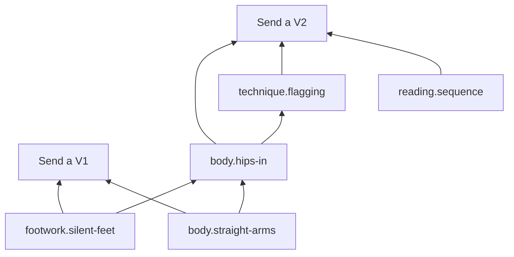

# Skill models

A **skill model** is all the content LAS needs for one skill: why options, six-month pictures, level checks, a ladder, the skill graph, lessons, drills, mistakes, proofs and safety fields. It's data, not code, and it plugs into the same onboarding screens, session blocks and engines as every other skill.

**The agent writes a skill model at runtime for whatever skill the learner picks** ([Any skill §6](any-skill.md#6-skill-models)). A **curated pack** is a skill model a person has reviewed and published. When one exists, the agent starts from it; when none exists, nothing is missing. LAS never needs a pack to work.

From v0.2 a skill model is a **scaffold** plus **fallback content** (§3.1). The live coach writes each session's screens as it goes; the pre-written lessons, items, headlines and why explanations are used only when no coach is present ([live coach](live-coach.md)).

Related: [live coach](live-coach.md) · [any skill](any-skill.md) · [learning loop](learning-loop.md) · [evaluation](evaluation.md) · [MCP and data](mcp-and-data.md) · [overview](../DESIGN.md)

The examples below use bouldering, but the same schema covers every skill.

---

## 1. Layout

A generated model is stored in the database as JSON. A curated pack is the same content as files, so people can review it in a pull request:

```
packs/bouldering/
├── model.yaml         name, engines, why[], pictures[], probes[], placement[], ladder[], access, injuries, safety, focus, key metrics
├── nodes/             skills and concepts with prerequisites (the skill graph)
├── lessons/           teaching-card specs (25 words per card or fewer); fallback content
├── drills/            drills of the standard types, with how difficulty rises (prompts and practice items are fallback content)
├── specs/             engine specs: metric, rubric, test and audio reference specs
├── mistakes/          detectors (written in the spec language) + fix drill; headline and explanation are fallback content
├── proofs/            proof standard for each ladder step, bound to an engine spec
├── warmups/           physical skills only
├── media/             reference clips, poses, audio (each file carries its license)
└── LICENSE            CC-BY-4.0 or CC0
```

Curated packs are written in YAML and compiled to the same JSON a generated model uses. The YAML parser is `yaml` (ISC).

## 2. Ladder and skill graph

The **ladder** is what learners see: steps with estimated hours and a proof standard. The **skill graph** is what the planner uses: each ladder step needs a set of skills, and skills depend on other skills.



```yaml
# nodes/body.hips-in.yaml
id: body.hips-in
name: Hips close to the wall
requires: [footwork.silent-feet, body.straight-arms]
lesson: lessons/hips-in.yaml
drills: [drills/hip-in-traverse.yaml, drills/hips-in-v0.yaml]
mistakes: [mistakes/hips-away.yaml]
mastery:
  evidence: [drill.outcome, attempt.analyzed]
  bkt: { p_init: 0.1, p_learn: 0.2, p_slip: 0.1, p_guess: 0.15 }
review: { card: "Where do your hips go on a vertical wall?", kind: hotspot }
```

## 3. Lessons and drills

```yaml
# lessons/hips-in.yaml
cards:
  - type: predict
    text: Which hip position puts less weight on your arms?
    options: [Close to the wall, Away from the wall]
    answer: 0
  - type: sim
    text: Drag your hips. Watch the arm load.
    sim: lean-model
    params: { hip_cm: [5, 60] }
    readout: arm_load_pct
  - type: compare
    text: Same hold, two climbers. Tap the difference.
    left: media/hips-in.mp4
    right: media/hips-out.mp4
    hotspot: hips
```

```yaml
# drills/hip-in-traverse.yaml
type: move
nodes: [body.hips-in]
engine: movement
spec: specs/hips-in.metric.yaml          # a metric spec (any-skill.md §3.1)
capture: { angle: side-45, duration_s: 60 }
needs: [climbing-gym]
success: "share(hip_wall_ok) >= 0.7"
difficulty: { param: wall_angle, levels: [vertical, slight-overhang, overhang] }
```

### 3.1 Scaffold and fallback content

| Part | Fields | Required | Used by |
|---|---|---|---|
| **Scaffold** | `skill`, `name`, `noun`, `physical`, `engines`, `fallbacks`; `why`, `pictures`, `probes`, `placement`; `ladder` with each step's proof; `nodes` (id, name, requires, lesson, drills, mistakes, bkt, review card, focus); `lessons` (id, title, nodes: a node names its lesson); `drills` (id, type, title, nodes, spec, capture, needs, success, difficulty, minutes, intensity, focus, fixes); `specs` (metric, rubric, test, audio reference, and items specs that a proof or probe uses); `mistakes` (id, name, nodes, engine, detector, severity, fix drill, resolved_after); `warmups`, `safety`, `access`, `injuries`, `focus`, `hard_focus`, `key_metrics`, `media` | Yes, as today | Onboarding, the planner, engines, proofs, safety, and the live coach (it builds on them and can't change them) |
| **Fallback content** | lesson `cards`; drill `prompt`; the `items` of items specs used only by practice drills; mistake `headline`; mistake `explain` (the why) | Optional in the schema, with defaults: `cards: []`, `items: []`, `headline: ""` (none), no `prompt`, no `explain`. Checked whenever present | The studio, only when no coach is present (or a present coach misses the screen deadline) |

- **The agent still writes all of it.** The skill tells the agent to write full fallback content at model time, and the agent evals require it. A session must never block on a model.
- **The validator still checks both.** Fallback content gets every check in §4 whenever it is present. When some is missing, the model still passes and `validate_skill_model` returns one warning (check `fallback`) per gap, naming what the studio does without a coach:

| Gap | Warning |
|---|---|
| A lesson with no cards | `lesson "<id>" has no cards: with no coach, the session skips it` |
| An items spec with no items | `spec "<id>" has no items: with no coach, drills that use it are skipped` |
| A drill with no prompt | `drill "<id>" has no prompt: with no coach, the studio shows its title` |
| A mistake with `headline: ""` | `mistake "<id>" has no headline: the fallback feedback will use its name` |
| A mistake with no `explain`, or one pointing at a lesson with no cards | `... the fallback feedback leaves out the Why button` |

- **Some items are scaffold.** An items spec that a level check (probe) or a proof reads must have its items: that's an error, not a warning.
- **Missing fallback never means invented text.** With no coach and no fallback, the session director skips to the next screen the scaffold can build, uses the drill's title for a missing prompt and the mistake's `name` for an empty headline, and leaves out the Why button. Warm-up and recall need no fallback: the director builds them from the scaffold (warm-ups, due review cards) and shows them itself.
- **A live coach fills the gaps.** A learn block whose lesson has no cards reaches the coach as a suggested lesson with no cards ("No pre-written cards: write them"); `coach_show(sk, "suggested")` refuses it, so the coach writes the cards.
- **Live content is checked the same way.** `coach_show` runs the same budget, type, reference and safety checks on each live screen ([live coach §7](live-coach.md#7-screen-catalogue)).
- **Curated packs need full fallback content**, so they work well with no coach.

## 4. Checks every skill model must pass

`validate_skill_model` (the MCP tool) and `las model validate` (the CLI) run the same checks on generated models and curated packs:

- the schema is valid, and every lesson card stays within the word budget;
- every ladder step has a proof bound to an engine spec, and every spec parses and uses known body points, functions and runners;
- every proof can be measured by an engine available on this machine, or is explicitly labeled self-report;
- the skill graph has no cycles, and every skill can be reached from step 0;
- every skill has at least one drill and one review card; every node names a lesson, whose cards are fallback content (no cards: a warning, §3.1);
- every mistake has a detector and a fix drill, and a headline and an explanation visual in the fallback content (missing: a warning, §3.1);
- drills use only the standard types;
- physical skills have a warm-up, injury questions, beginner intensity caps and stop criteria, and supervised-only activities are flagged ([Any skill §7](any-skill.md#7-physical-safety-for-skills-nobody-has-reviewed));
- every media file declares a license from the allowed list (CC0, CC-BY, or the learner's own file kept on their device).

`las model preview` opens the studio with a model loaded, including onboarding.

## 5. Generated and curated

| Source | Who writes it | Shown to learners as | How it improves |
|---|---|---|---|
| **Generated** (the default) | The agent, for this learner, at runtime | Estimates as ranges; "Early" label on the ladder | Thresholds calibrated from the learner's own attempts; disputes and weekly-review feedback flag problems |
| **Curated** | A person reviews a generated model (or writes one) and publishes it in `packs/` through a pull request | No label | Reviews, real hour data, reference media with consent |

- **Promotion:** a generated model can be exported (`las model export`) and opened as a pull request. Review checks the ladder, safety fields and specs.
- **Updates:** curated packs are versioned. A learner's model records the version it came from, and the agent can offer to merge improvements.

## 6. Content licensing

- Curated pack text and data: **CC-BY-4.0 or CC0**.
- Media in curated packs: each file declares its license, and only CC0 or CC-BY is accepted. Reference clips need written consent from the people in them.
- **Learner-supplied references** (a teacher's clip, a score the learner owns) stay on the learner's device. They're used only for that learner and never published.
- **Music:** chord progressions and patterns are fine. Lyrics, recordings and sheet music of copyrighted songs aren't included in packs. A milestone can still name a song; the learner brings the song.
- **Language content:** dialogues are written for the model. No textbook excerpts.
