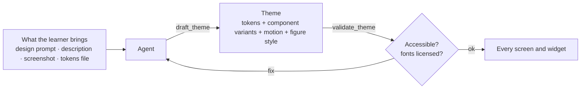

# Theming: the learner picks the look

LAS has **no fixed visual design language**. The learner chooses a look, and every surface follows it:
- onboarding and Today;
- lessons, simulations and drills;
- recording screens and evaluation overlays;
- progress, proof cards, and the MCP Apps widgets inside the chat.

The prototype's look is only a demo of the flows. It is not the product's style.

Related: [overview](../DESIGN.md) · [any skill](any-skill.md) · [learning loop](learning-loop.md) · [MCP and data](mcp-and-data.md)

---

## 1. How it works

This follows the same pattern as skills. The agent turns whatever the learner brings into a **theme**: data that LAS validates and applies everywhere. There's no theme-specific code.



## 2. What the learner can bring

| Input | Example | Notes |
|---|---|---|
| **A design prompt** | A style copied from a gallery such as [designprompts.dev](https://www.designprompts.dev/) (31+ named styles), or a `DESIGN.md` from another project | The learner pastes the text. LAS never bundles third-party prompts and doesn't depend on any gallery being online |
| **A description** | "Cozy, like a paper notebook", "dark and neon, like an arcade" | The agent asks one or two short visual questions if it needs to |
| **An image** | A screenshot of an app or site they like | The agent reads it with its vision model, or with a local open vision model when its own is text-only |
| **A tokens file** | W3C design-tokens JSON, CSS custom properties, Tailwind config | Mapped directly onto the theme's tokens |
| **Nothing** | "Skip" | The neutral base theme (§6) |

**When the learner chooses:** it's the first, optional screen of onboarding ("Pick a look", with a skip), so everything after it is already themed. They can change it any time from Settings, or by asking the agent ("make it warmer", "less rounded"). The agent applies that as a small edit to the current theme.

**Per skill:** a learner can keep one look for everything or give each skill its own (say, a calm one for yoga, a terminal-style one for Rust).

## 3. The theme spec

All of it is data. Anything a theme leaves out falls back to the base theme.

```yaml
name: Paper Notebook
source: { kind: prompt, note: "Pasted by the learner" }      # never stores third-party text unless the learner chose to
modes: [light]                                              # light, dark, or both; single-mode themes are allowed
tokens:
  color:                                                    # semantic roles, never raw colors in components
    bg: "#F7F3EA"; surface: "#FFFDF7"; ink: "#22201C"; muted: "#6B655A"; line: "#D9D1C1"
    accent: "#2F5D8A"; on_accent: "#FFFFFF"
    good: "#2E7D4F"; warn: "#B4541E"; bad: "#A3262B"; focus: "#2F5D8A"
    data: ["#2F5D8A", "#C07A1E", "#4E8F5B", "#8C4A7A", "#5E6B78"]   # chart and overlay series
  type:
    display: { family: "Fraunces", fallback: "Georgia, serif", weight: 600, license: OFL-1.1 }
    body:    { family: "Literata", fallback: "Georgia, serif", license: OFL-1.1 }
    mono:    { family: "IBM Plex Mono", fallback: "ui-monospace, monospace", license: OFL-1.1 }
    scale: [13, 15, 17, 21, 27, 34]
  space: [4, 8, 12, 16, 24, 32]
  radius: { sm: 2, md: 4, lg: 8, pill: 999 }
  border: { width: 1.5, style: solid }
  shadow: { card: "none", raised: "2px 2px 0 var(--ink)" }  # hard shadows, soft shadows or none
  density: comfortable                                      # compact, comfortable or roomy
components:                                                 # variants from a fixed menu per standard component
  card: outlined                # flat, outlined, raised, hard-shadow, glass
  button: square                # pill, rounded, square, underline
  chip: outlined                # filled, outlined, tag
  tile: outlined                # flat, outlined, raised, hard-shadow
  progress: steps               # bar, dots, steps
  route: path                   # ladder, path, map, timeline
  meter: ticks                  # bar, ring, ticks
motion: { personality: subtle, duration_ms: 180, easing: "ease-out" }   # none, subtle, snappy, springy
figures:                        # SVG diagrams, pose overlays, charts and lesson sims
  stroke: 2; corner: round; fill: flat                      # flat, hatched, outline
  overlay: { good: good, attention: warn, reference: data.0 }
texture: { kind: grain, strength: 0.04 }                    # none, grain, grid, dots, gradient (CSS only)
voice: plain                    # plain, warm, playful, terse: picks LAS's built-in copy set, never writes new copy
```

- **Colors are roles, not values.** Components only ever reference roles (`accent`, `good`, `data[2]`), so any palette works everywhere, including evaluation overlays and charts.
- **Variants come from a fixed menu.** Each standard component has a small set of built-in treatments. A theme picks from the menu and can't add CSS of its own. That keeps every theme safe to validate and keeps widgets working inside chat clients.
- **Metaphors are themable too.** The route to the milestone can be drawn as a ladder, a path, a map or a timeline. Climbing holds were just the prototype's demo.

## 4. Checks before a theme is used

`validate_theme` rejects or auto-fixes a theme before any screen uses it:

| Check | Rule |
|---|---|
| Text contrast | WCAG AA in every declared mode: 4.5:1 for body text, 3:1 for large text and for control boundaries |
| Evaluation colors | `good`, `warn` and `bad` each reach 3:1 against `bg` and `surface`, and they're told apart by more than color (icons and labels are always shown too) |
| Chart and overlay colors | The `data` series stay distinguishable for the common types of color blindness |
| Focus | A visible focus ring at 3:1 or more |
| Touch targets | At least 44 px, whatever the density |
| Motion | `prefers-reduced-motion` always wins; durations capped |
| Fonts | Each family carries an allowed license (OFL, Apache-2.0, or another from DESIGN §11) and is cached locally for offline use. Otherwise the fallback stack is used |
| Assets | No external images or files unless their license is allowed. Textures are CSS only |

The agent gets each failure with a suggested fix (e.g. "darken `muted` to #5F594F for 4.5:1") and resubmits. A theme that never passes is never applied.

## 5. Where the theme applies

- **Studio PWA:** tokens become CSS custom properties on the root element. Component variants are data attributes (`data-card="hard-shadow"`). Switching themes is instant and needs no reload.
- **MCP Apps widgets:** each widget receives the learner's theme. If the host sends its own light or dark mode and the theme supports both, the widget follows the host's mode.
- **Figures and overlays:** pose skeletons, mistake markers, beat timelines, charts and lesson sims are drawn from `figures` and the color roles. Feedback looks native to the theme while staying readable.
- **Exports:** proof cards and progress snapshots use the theme too.

## 6. Base theme

There's one neutral, accessible base theme. It's used before the learner chooses, for anything a theme leaves out, and whenever validation fails. It's deliberately plain so it never competes with the learner's choice.

## 7. Tools and data

| Tool | Input | Output |
|---|---|---|
| `draft_theme` | `{prompt? , description?, image?, tokens?}` | A theme spec, plus the agent's notes on how it read the input |
| `validate_theme` | `Theme` | `{ok, errors[], fixes[]}` |
| `preview_theme` | `Theme, screen?` | A widget showing the learner's own Today, a lesson and a feedback card in that theme |
| `set_theme` | `themeId, scope: all \| sk` | Applies it everywhere, or to one skill |
| `get_theme` | `sk?` | The active theme |

Data: `theme(id, learner_id, name, source_kind, json, validated_at)` and `theme_scope(learner_id, enrollment_id?, theme_id)`.

## 8. Testing

- **Every screen must render with any valid theme.** Snapshot tests run the main screens (onboarding, Today, a lesson, a recording screen, feedback with overlays, progress, a widget) in at least 6 very different themes: brutalist, monochrome serif, playful rounded, dark neon, glass, high contrast. They check:
  - nothing overflows or overlaps;
  - every contrast check passes;
  - every variant on the component menu is exercised.
- **A lint rule fails the build** on any hard-coded color, font, radius or shadow in component code.
